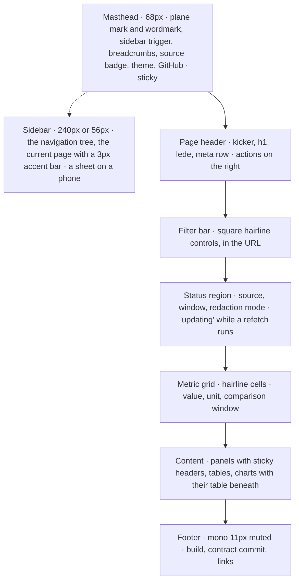
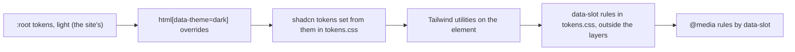

# CWA dashboard style guide

This guide records the visual language the dashboard shares with the CWA website, so that every page of `contextwindowarchitecture/dashboard` reads as one family with the site, the spec, the assembler demo and the benchmark site. It is the website's style guide (`contextwindowarchitecture/website`, `STYLE.md`, measured from its pages on 2026-09-28, taken here at commit `47c6ef4`) applied to this app: the tokens, the type, the rules and the hover states are the site's; the components are the dashboard's. When a page and this guide disagree, fix the page unless the page is one of the deliberate exceptions named in section 10. When the website's guide moves, re-read it, carry the change here in one commit, and record the website commit in this paragraph.

The dashboard is a React application built with Vite, styled by Tailwind utilities that resolve to one token stylesheet, `apps/web/src/styles/tokens.css`, over the generated shadcn stylesheet `globals.css`. Every colour, size and radius a component uses comes from a token in section 2; nothing is styled by a literal value. `pnpm test` checks the parts of this guide a test can check (section 9). The working plan (`docs/plans/dashboard-plan.md`, local) names which page uses which component.

## 1. Character

Warm, flat, typographic, hairline, editorial. The dashboard is an instrument, so it is denser than the site, but it is the same paper, the same ink and the same two typefaces.

- **Paper, not white.** Backgrounds are warm off-white neutrals with a hint of yellow (OKLCH hue 80 to 90), never pure white or pure black. Dark mode is the same warm hue inverted.
- **One accent.** A single clay orange carries every emphasis: kickers, links, the primary button, the current page, and the two things an assembler decides against: a refusal and an exclusion. Nothing else is coloured except the four plane colours, which are semantic, never decorative: an item is coloured by the plane its slot belongs to, and by nothing else.
- **Two typefaces with strict jobs.** Space Grotesk sets everything a reader reads. IBM Plex Mono sets everything a machine or a spec would say: labels, kickers, identifiers, slot names, reason codes, requirement numbers, counts, digests, hashes, timestamps, code, the footer.
- **Hairlines and squares.** Structure comes from 1px lines and 1px-gap grids, not from shadows, gradients or rounded cards. The only radius is the pill on buttons and chips.
- **Big, tight display type.** Page titles run to 44px with negative tracking and a line-height near 1, over quiet mono metadata.
- **Motion is a decision too.** Hover states switch instantly and nothing decorates itself. Motion exists where it shows a sequence a still page cannot: a session played turn by turn, a trace walked stage by stage, a replay settling against its original, and the site's short rise on a row that arrives (section 7). Illustration exists in three named places, drawn in the tokens (section 7).
- **Colour is a decision.** A coloured thing on a page is always something an assembler decided or a slot's plane: an outcome, never a category, a language, a status of the app, or decoration.

## 2. Tokens

`tokens.css` declares the website's custom properties on `:root`, with the dark override on `html[data-theme="dark"]`, verbatim, and then sets every generated shadcn token from them (section 9), so a component that only uses the generated tokens is already in the site's colours. Colours are authored in OKLCH; the hex columns are the sRGB conversions and exist only for handoff to tools that cannot read OKLCH. A test holds the stylesheet's block and this table to one set of values, and holds every colour used as text to 4.5:1 against `--bg` and `--surface` in both themes, so a token change that fails WCAG AA fails the build.

| Token | Role | Light | Light hex | Dark | Dark hex |
|---|---|---|---|---|---|
| `--bg` | Page, panel and card interiors | `oklch(0.985 0.004 90)` | `#fbfaf7` | `oklch(0.175 0.008 80)` | `#12100d` |
| `--surface` | The sidebar, quiet cards, item rows, table head bands, skeletons | `oklch(0.955 0.005 90)` | `#f1f0ec` | `oklch(0.215 0.008 80)` | `#1b1915` |
| `--fg` | Primary text, the current thing, emphasis borders | `oklch(0.20 0.010 80)` | `#181611` | `oklch(0.955 0.004 90)` | `#f1f0ed` |
| `--muted` | Secondary text, labels, metadata, nav at rest, chips at rest | `oklch(0.52 0.010 80)` | `#6c6863` | `oklch(0.68 0.010 85)` | `#9b9891` |
| `--line` | Every border and divider, chart axes, the meter track | `oklch(0.885 0.006 90)` | `#dad9d5` | `oklch(0.305 0.008 80)` | `#312f2b` |
| `--accent` | Emphasis, links, primary button, the current page, refusal, exclusion, drift | `oklch(0.55 0.20 38)` | `#cb3000` | `oklch(0.74 0.17 45)` | `#ff8244` |
| `--accent-soft` | Hover fills, note callouts | `oklch(0.94 0.035 45)` | `#ffe5d8` | `oklch(0.30 0.045 45)` | `#41261a` |
| `--p-gov` | Governance plane | `oklch(0.55 0.17 38)` | `#bf4213` | `oklch(0.76 0.15 45)` | `#fe8f5b` |
| `--p-state` | State plane | `oklch(0.53 0.14 250)` | `#166eb9` | `oklch(0.76 0.12 250)` | `#73b6fa` |
| `--p-evid` | Evidence plane | `oklch(0.52 0.13 155)` | `#007e46` | `oklch(0.76 0.13 155)` | `#65c98c` |
| `--p-inter` | Interaction plane | `oklch(0.54 0.15 310)` | `#8951af` | `oklch(0.76 0.13 310)` | `#ca99ef` |

Non-colour tokens shared with the site:

| Token | Value |
|---|---|
| `--sans` | `'Space Grotesk', Helvetica, Arial, sans-serif` |
| `--mono` | `'IBM Plex Mono', monospace` |
| `--pill` | `999px` |

The block that `tokens.css` carries, verbatim:

```css
:root {
  --sans: 'Space Grotesk', Helvetica, Arial, sans-serif;
  --mono: 'IBM Plex Mono', monospace;
  --pill: 999px;
  --bg: oklch(0.985 0.004 90);
  --surface: oklch(0.955 0.005 90);
  --fg: oklch(0.20 0.010 80);
  --muted: oklch(0.52 0.010 80);
  --line: oklch(0.885 0.006 90);
  --accent: oklch(0.55 0.20 38);
  --accent-soft: oklch(0.94 0.035 45);
  --p-gov: oklch(0.55 0.17 38);
  --p-state: oklch(0.53 0.14 250);
  --p-evid: oklch(0.52 0.13 155);
  --p-inter: oklch(0.54 0.15 310);
}
html[data-theme="dark"] {
  --bg: oklch(0.175 0.008 80);
  --surface: oklch(0.215 0.008 80);
  --fg: oklch(0.955 0.004 90);
  --muted: oklch(0.68 0.010 85);
  --line: oklch(0.305 0.008 80);
  --accent: oklch(0.74 0.17 45);
  --accent-soft: oklch(0.30 0.045 45);
  --p-gov: oklch(0.76 0.15 45);
  --p-state: oklch(0.76 0.12 250);
  --p-evid: oklch(0.76 0.13 155);
  --p-inter: oklch(0.76 0.13 310);
}
```

### The dashboard's own tokens

The dashboard adds a type scale and a few measures so that density is set in one place. They carry no colour. Every fixed size in a component is one of these or a value from the scale in section 4.

| Token | Value | Used for |
|---|---|---|
| `--fs` | `15px` | body inside panels and cards |
| `--fs-sm` | `14px` | secondary body, table cells, descriptions |
| `--fs-label` | `11px` | uppercase mono labels, chips, table heads |
| `--fs-kicker` | `12px` | accent kickers |
| `--fs-mono` | `12.5px` | identifiers, metadata, code, JSON |
| `--fs-title` | `16px` | card, panel and column titles |
| `--fs-h3` | `22px` | section titles inside a page, empty-state titles |
| `--fs-lede` | `18px` | the description under a page title |
| `--control` | `36px` | select and input height, the primary button |
| `--control-sm` | `30px` | ghost buttons in rows, filter controls |
| `--mast-h` | `68px` | the masthead |
| `--sidebar-w` | `240px` | the expanded sidebar |
| `--sidebar-w-icon` | `56px` | the collapsed sidebar |

### Fonts

The site loads its fonts from Google Fonts. The dashboard's deployed policy serves fonts from the site's own origin only, so the same families come from packages, `@fontsource-variable/space-grotesk` (400 to 700) and `@fontsource/ibm-plex-mono` (400, 500, 600), imported once in `globals.css`. Do not request other weights; components only ever use 500, 600 and 700 on top of the 400 default.

## 3. Colour usage

Reference every colour through a token. `src/` contains no literal colour outside `tokens.css`; a test fails when one appears. The permitted mixes are `color-mix(in oklab, var(--bg) 88%, transparent)` for the masthead's translucent background and `color-mix(in oklab, var(--plane) 50%, transparent)` for a compressed item's plane rule and a compressed segment of the budget bar.

- **`--bg` and `--surface` alternate.** The page and the panel interiors are `--bg`; the sidebar, quiet cards, item rows, table head bands and loading skeletons are `--surface`. Narrative pages (About, Telemetry) alternate sections bg, surface, bg, each separated by a 1px `--line` top border, as the site does.
- **`--fg` is for reading and for the current thing.** Body text, titles, the selected row, the selected turn, the active tab, the emphasis panel's border, the conflict chip's border.
- **Inverse fill means *you are here*.** The pressed state of a segmented control and the selected turn's pill (`--fg` fill, `--bg` text). Nothing else inverts.
- **`--muted` is the default for anything secondary.** Descriptions, every label and kicker inside a card, metadata rows, nav links at rest, the footer, chips at rest, chart axis labels. A block is muted unless it is the one thing the reader must read next.
- **`--accent` is emphasis, never texture.** Section kickers, links, the primary button, the current page's bar in the sidebar, the active tab's underline, the note callout's border, text selection, and the three things the dashboard is about: a refusal (the outcome banner, the refused turn in a timeline), an exclusion (the reason-code chip, the excluded rows) and drift (a service or an event on a contract or a registry entry other than the locked one). Never as running text, never as a large fill other than the primary button and the loud chip.
- **`--accent-soft` is a fill only.** Hover fill on clickable rows and grid cells, and the background of the note callout.
- **`--line` is every border.** Hairline grids, panel borders, dividers, table rules, the ghost button and chip outline, chart axes and gridlines, the budget bar's track, the dashed borders of empty states and producer-excluded rows. Only the note callout (`--accent`), the emphasis panel and the conflict chip (`--fg`), the refused row (`--accent`, dashed), ghost buttons on hover (`--fg`) and the focus ring (`--accent`) use another border colour.

### Plane colours

The four plane colours are the only other chroma and always mean the plane they are named for.

| Token | Plane | Slots | What the plane answers |
|---|---|---|---|
| `--p-gov` | Governance | `governance.*` | Who may direct the model |
| `--p-state` | State | `state.*` | What is true right now |
| `--p-evid` | Evidence | `evidence.*` | What the model may ground on |
| `--p-inter` | Interaction | `interaction.*` | What has happened, and what is asked |

A slot's plane is the part of its id before the dot, read from the contract's `model.json`; a component sets `--plane` on the element from it. Where the plane colours appear, and nowhere else:

- The plane mark beside the wordmark in the masthead: a 2 by 2 grid, 18px square, 2px gap, in the order governance, state, evidence, interaction.
- Slot badges: the slot id in mono, text in the plane colour, on a `--line` outline.
- Item rows: a 3px left border in the slot's plane (full for an included item, mixed to 50% for a compressed one).
- Segments of the budget bar and of the turn timeline's stacked bars, one per plane, at 50% for the compressed share.
- The placement strip: each placed slot's chip carries its plane colour as text.
- Legend swatches: an 8px square in the plane colour before the plane's name.

Do not use a plane colour for a status, a category, a producer, a language or a chart series that is not a plane.

### Outcomes

The dashboard's outcomes are what the assemblers decided. Each is carried by ink, the accent, the plane and weight, never by a colour of its own. Every chip carries its word: colour is never the only signal.

| Outcome | Row | Chip |
|---|---|---|
| assembled (an event) | unchanged | fg text on a `--line` border: "assembled · 3,740 tokens" |
| refused (an event) | the outcome banner is the note callout | accent text and border: the refusal code as an identifier |
| rejected (an event, no trace) | the outcome banner is the note callout | accent text and border: "rejected · n problems" |
| included | 3px left border in the slot's plane | plane-coloured text: "included · 51 tokens" |
| compressed | 3px left border in the plane at 50% | fg text: "compressed 66 → 30" |
| excluded by the assembler | `--line` border, id struck through, facts at 70% | accent text and border, the reason code as an identifier |
| admitted, assembly refused | 1px dashed `--accent` border, whole row at 70% | accent text and border: "admitted · assembly refused" |
| not placed | `--line` border, row at 55% | muted: "not placed" |
| reported excluded by the producer | 1px dashed `--line` border, row at 70% | muted, the reason code then "· producer" |
| in a declared conflict group | unchanged | fg text and fg border, the group id as an identifier |
| on the locked contract or registry entry | unchanged | fg text on a `--line` border: "contract · 9f84c2e" |
| drifted from it | unchanged | accent text and border: "contract · differs" |
| redacted body | unchanged | muted: "digest_only" with the setting that reveals it beside |

The chip ladder, from quietest to loudest: muted text on a `--line` border; fg text on a `--line` border; fg text on an `--accent` border (unreviewed, derived, demo); accent text on an `--accent` border (a reason code, a refusal, drift); `--bg` text on an `--accent` fill (the one loudest thing on a page: parity lost, a live run that differs from replay).

### Languages and services

The four assemblers and the services that run them are categories, not outcomes, and have no hue. A language is carried by its word in mono and a symbol mark in `currentColor`: Python a circle, TypeScript a square, Go a triangle, Rust a diamond, 8px, before the word. In a chart a language's series is distinguished by that symbol and by line style (solid, dashed, dotted, dash-dot), drawn in `--fg` and `--muted`, never by a colour.

### Dark mode

The theme is an attribute, `data-theme="light"` or `"dark"`, on `<html>`. The app reads `localStorage["cwa-theme"]` before the first paint (`public/theme.js`), defaults to `light`, and writes the choice back when the masthead toggle is pressed. The toggle's label names the theme you would switch to ("dark" while light), in the website's lowercase mono. The storage key is the website's, so a browser that chose a theme on the site opens the dashboard in it. Everything else follows from the token override, so a component that only uses tokens needs no dark-mode work. The masthead's translucent background uses `color-mix(in oklab, var(--bg) 88%, transparent)` so it adapts too. `prefers-color-scheme` is not consulted.

## 4. Typography

### Families

- `var(--sans)` for titles, descriptions, body copy, buttons with words, nav links.
- `var(--mono)` for kickers and labels, identifiers, event and session ids, slot and requirement names, reason codes, producer ids, counts, tokens, hashes, digests, timestamps, code, JSON, textareas, the ghost button, chips, the footer. If it would be uppercase, tracked, or read by a machine, it is mono.

### Scale

| Role | Family | Size | Weight | Tracking | Line-height | Measure | Notes |
|---|---|---|---|---|---|---|---|
| Narrative page title (About, Telemetry, Glossary) | sans | `clamp(38px, 5.4vw, 72px)` | 700 | `-0.045em` | `0.96` | `16ch` | `text-wrap: balance` |
| Dashboard page title (h1) | sans | `clamp(28px, 3.6vw, 44px)` | 700 | `-0.035em` | `1.02` | `24ch` | `text-wrap: balance`; the site's h2 scale |
| Section title (h2) | sans | `var(--fs-h3)` 22px | 600 | `-0.02em` | `1.2` | none | `margin: 0 0 12px` |
| Card, panel and column title | sans | `var(--fs-title)` 16px | 600 | `-0.015em` | `1.35` | | |
| Lede, page description | sans | `var(--fs-lede)` 18px | 400 | none | `1.6` | `64ch` | `color: var(--muted)`, `text-wrap: pretty` |
| Body | sans | `var(--fs)` 15px | 400 | none | `1.6` | `70ch` | `text-wrap: pretty` |
| Secondary body, table cells | sans | `var(--fs-sm)` 14px | 400 | none | `1.55` | | muted in cards |
| Nav link | sans | `14px` | 500 | none | | | 16px in the mobile sheet |
| Button label | sans | `14px` | 600 | none | | | |
| Kicker, accent | mono | `var(--fs-kicker)` 12px | 400 | `0.14em` | | | uppercase, `color: var(--accent)`, `margin-bottom: 14px` |
| Label, muted | mono | `var(--fs-label)` 11px | 400 | `0.12em` | | | uppercase, `color: var(--muted)`, `margin-bottom: 8px` |
| Metric value | mono | `clamp(26px, 2.6vw, 34px)` | 600 | `-0.02em` | `1.05` | | `font-variant-numeric: tabular-nums` |
| Identifier, metadata, code, JSON | mono | `var(--fs-mono)` 12.5px | 400 | none | `1.6` to `1.7` | | |
| Chip, table head | mono | `var(--fs-label)` 11px | 400 | `0.08em` chips, `0.12em` heads | `1` | | uppercase; an identifier chip keeps its case |
| Footer, ghost button | mono | `12px` | 400 | `0.05em` on buttons | `1.65` | | |
| Small mono note, chart axis label | mono | `11px` | 400 | `0.04em` | `1.7` | | never smaller |

Rules that fall out of the table:

- Display sizes are fluid `clamp()` values; everything 22px and under is a fixed pixel size through a token. Never use `rem` or `em` for size.
- Tracking is negative on anything 16px and larger in sans and positive on every uppercase mono label. Body text has none.
- Line-height drops as size rises: near 1 for titles, `1.35` for card titles, `1.55` to `1.6` for prose, up to `1.7` in code.
- Every paragraph and multi-line title sets `text-wrap: pretty`; `balance` is reserved for page titles.
- Measure is set with `max-width` in `ch`: `70ch` for body, `64ch` for ledes, `16ch` to `24ch` for titles.
- Weights: 700 for page titles, 600 for section and card titles, buttons, metric values and inline emphasis, 500 for nav links, 400 for everything else. Never 300 or 800.
- Numbers are tabular (`font-variant-numeric: tabular-nums`) in every table cell, metric and chart label, and right-aligned in table cells.

### Casing and punctuation

- **Kickers and labels are uppercase mono with middle dots.** "Traces · support-chat · illustrative/v1", "Session · sess_9941 · 5 turns", "Replay · assembler-typescript · 0.0.1". Separate facets with ` · ` (space, U+00B7, space); dates are ISO, UTC, with the viewer's zone on hover.
- **Headings are sentence case.** Page titles are noun phrases without a period: "Trace stream", "Placement profiles". Section titles too.
- **Identifiers keep their case.** Reason codes (`expired`, `missing_field:relevance`), slots (`evidence.knowledge`), profile ids, producer ids, hashes and digests are written exactly as the contract or the event writes them, in mono, never uppercased and never translated.
- **Requirements are cited as R-n** and link to the glossary's entry, which quotes the specification and links to `#R-n` on the spec page.
- **Browser titles** follow "Page name — CWA dashboard", with a spaced em dash; a record page prefixes its id: "trc_01J9 … — Traces — CWA dashboard".
- Numbers are formatted with `Intl.NumberFormat("en-US")` through `lib/format.ts`, with the unit named ("3,740 tokens", "0.78 ms", "92 of 5,000"); a missing value is "Not available", never 0 or a dash in a numeric cell.

## 5. Layout and spacing

### Frame

Dashboard pages are full width inside the sidebar: the tables need it. Narrative pages use the site's container.

| Measure | Value |
|---|---|
| Masthead | `var(--mast-h)` (68px), sticky, `z-index: 50`, blurred `--bg` at 88%, 1px `--line` bottom border |
| Sidebar | `var(--sidebar-w)` expanded, `var(--sidebar-w-icon)` collapsed, `--surface`, 1px `--line` right border, scrolls independently; a sheet below 900px |
| Page gutter | `32px`, tightened to `20px` below 900px |
| Page header | `padding: 32px 32px 24px`: kicker, h1, lede, the mono meta row, actions on the right |
| Filter bar | `padding: 0 32px 16px`, controls in a row that wraps, `gap: 10px` |
| Status region | `padding: 0 32px 16px`, the source badge and the window as mono muted |
| Metric grid | `margin: 0 32px 24px`, a hairline grid of `repeat(auto-fit, minmax(220px, 1fr))` |
| Content | `padding: 0 32px 32px`, a column of panels with `gap: 24px`; a two-column page is `minmax(0, 1fr) minmax(360px, 420px)` with `gap: 24px` |
| Panel header | `padding: 12px 18px`, 1px `--line` bottom border, sticky at the masthead's bottom inside a scrolling panel |
| Panel body | `padding: 18px`; tables run edge to edge inside it |
| Narrative container | `max-width: 1180px; margin: 0 auto`, sections `padding: 72px 32px 88px` alternating `--bg` and `--surface` |
| Footer | `padding: 24px 32px`, 1px `--line` top border |
| Anchor offset | `scroll-padding-top: calc(var(--mast-h) + 20px)` on `html` |



### Spacing values

Only these gaps and paddings appear. Pick the nearest rather than inventing one.

- Micro: `1px` (hairline gutters), `2px`, `3px`, `4px`, `6px`.
- Component: `8px`, `10px`, `12px`, `14px`, `16px`, `18px`, `20px`, `22px`, `24px`, `26px`, `28px`.
- Section: `32px`, `40px`, `56px`, `72px`, `88px`, `96px`.

Common pairs: metric cells `18px 20px`; panel headers and key-value rows `12px 18px`; item rows `10px 14px`; cards inside a panel `12px 14px`; table cells `6px 8px`; primary button `9px 18px`; ghost button `8px 14px` or `7px 14px`; chips `3px 8px`; narrative cells `24px 22px`. Vertical rhythm inside a panel uses bottom margins of `14px`, `18px` or `24px`; nothing uses top margins except the `14px` spacer above a section label inside a panel.

### Grid recipes

- **Hairline grid** (cells that share borders): the container carries the lines, the cells carry the fill.
  `display: grid; gap: 1px; background: var(--line); border: 1px solid var(--line);` with each cell `background: var(--bg);`. The metric grid, the guardrail cards, the registry cards, the conflict cards and the narrative pages' card rows are hairline grids.
- **Responsive card grid:** `repeat(auto-fit, minmax(220px, 1fr))` for metrics, `minmax(280px, 1fr)` for guardrail and registry cards, `minmax(360px, 1fr)` for conflict cards, always as a hairline grid.
- **Key and value rows** (an event's context, a policy's flags, a profile's evaluation): `grid-template-columns: 140px minmax(0, 1fr); gap: 14px; padding: 12px 18px; border-bottom: 1px solid var(--line); align-items: baseline;` with the key in mono `var(--fs-label)` muted and the value in mono `var(--fs-mono)`.
- **Item row:** `grid-template-columns: minmax(0, 1fr); gap: 5px` inside the row; the outcome chips, the id, the metadata line (producer, authority, trust, tier, lineage, freshness, expires, tokens), the body behind a `<details>`.
- **Two-column page** (the inspector's items and its context, a session's timeline and its turn): `minmax(0, 1fr) minmax(360px, 420px); gap: 24px`, stacking below 1100px.

### Breakpoints

Responsive rules are Tailwind's screen variants or `@media (max-width: …)` blocks at the end of `tokens.css`, selecting by class or `data-slot`. No `!important` is needed, because nothing is styled inline.

| Max width | Rule |
|---|---|
| `1200px` | The sidebar collapses to icons by default; the user can expand it and the choice is kept |
| `1100px` | Two-column pages stack; the metric grid flows to two per row |
| `900px` | The sidebar becomes a sheet opened by the masthead trigger; every gutter tightens to `20px`; the breadcrumbs keep only the last two crumbs |
| `720px` | Tables keep their columns and scroll inside a labelled horizontal region; the page body never scrolls sideways |
| `620px` | The metric grid is one column; the filter bar's controls go full width; chips wrap under their row's id |

Layers: the masthead block sits at `z-index: 50`, the sidebar sheet at `85`, dialogs at `90`, sticky panel and table headers at `2`. Nothing else is layered.

## 6. Components

Snippets name the generated shadcn primitive where one is used and the rules in `tokens.css` that restyle it through its `data-slot` (section 9); hover states are ordinary `:hover` rules.

### Masthead

```css
[data-slot="masthead"] { position: sticky; top: 0; z-index: 50; height: var(--mast-h); background: color-mix(in oklab, var(--bg) 88%, transparent); backdrop-filter: blur(12px); border-bottom: 1px solid var(--line); display: flex; align-items: center; gap: 28px; padding: 0 32px; }
```

Order left to right: the sidebar trigger (a ghost pill), the plane mark and the wordmark "CWA" (`font-weight: 700; letter-spacing: -0.02em; font-size: 16px`, `--fg`) with "dashboard" beside it in `14px` muted, the breadcrumbs, a spacer (`margin-left: auto`), the source badge (mono, muted: the event root and its generated-at time, with Refresh as a ghost button), the theme ghost button, the GitHub inverse button. The wordmark link is `min-height: 24px`, the WCAG 2.2 target size.

### Sidebar

The generated `Sidebar`, `SidebarInset` and `SidebarTrigger`, restyled: `--surface` with a 1px `--line` right border, no shadow, no radius. Groups are muted mono labels; items are `14px` 500 sans in `--muted` hovering to `--fg`, `padding: 10px 14px`, with an 18px Lucide line icon in `--muted` before the word. The current page is `--fg` with `border-left: 3px solid var(--accent); padding-left: 11px` and `aria-current="page"`. Collapsed, the icon alone shows and the word is its tooltip. On a phone the same tree opens as a sheet from the left, `min(320px, 100%)` wide, `--bg`, a 1px `--line` right border, and the trigger's label reads "Menu" or "Close". The desktop preference persists; the sheet never reopens because the desktop tree was expanded.

### Breadcrumbs

Mono `var(--fs-mono)` muted, separated by ` / ` in `--line`, the last crumb in `--fg`; each earlier crumb a link hovering to `--fg`. Breadcrumbs reflect hierarchy (Traces / trc_01J9…), not history.

### Page header

A kicker (the sidebar group, or the record's facets), the h1, the lede in `--muted` at `64ch`, then the mono meta row: facets separated by middle dots, identifiers in `--fg`, links in `--accent`. Actions sit on the right in a row that wraps: ghost pills, and at most one primary.

### Buttons

All buttons are pills. A `<button>` always sets `font-family` explicitly because the browser default would not. The generated `Button` is restyled to these through its `data-slot`; its variants map `default` to primary, `outline` to ghost, `secondary` to inverse, `ghost` to the text link.

| Variant | Style | Hover |
|---|---|---|
| Primary (Replay, Refresh, Download) | `font-family: var(--sans); font-size: 14px; font-weight: 600; color: var(--bg); background: var(--accent); border-radius: var(--pill); padding: 9px 18px; border: 0; cursor: pointer;` | `background: var(--fg)` |
| Inverse (GitHub, the pressed segment) | as the ghost pill, with `background: var(--fg); color: var(--bg); border-color: var(--fg)` | unchanged |
| Ghost (theme, menu, copy, clear, download index, retry) | `font-family: var(--mono); font-size: var(--fs-label); letter-spacing: 0.05em; color: var(--muted); background: transparent; border: 1px solid var(--line); border-radius: var(--pill); padding: 8px 14px; cursor: pointer;` | `color: var(--fg); border-color: var(--fg)` |
| Ghost, small uppercase (in rows and chips) | the ghost at `font-size: var(--fs-label); letter-spacing: 0.08em; text-transform: uppercase; padding: 7px 14px` | same as ghost |
| Segmented (outcome, language, mode) | a row of ghost pills sharing one outline; the pressed one is the inverse pill and carries `aria-pressed` | same as ghost |

Labels are sentence case: "Replay in sandbox", "Download trace", "Clear filters". The theme and menu buttons are the exception, in the website's lowercase mono: "dark", "menu". A disabled button is at `opacity: 0.5` with `cursor: not-allowed`; a busy button keeps its label and sets `aria-busy`; there is no loading spinner on a button.

### Form controls

Selects, inputs, number fields and the date range are square hairline boxes, not pills: they are fields, not buttons. `font-family: var(--mono); font-size: var(--fs-mono); color: var(--fg); background: var(--bg); border: 1px solid var(--line); height: var(--control-sm); padding: 0 10px;`. The generated `Select` and `Input` are restyled to this (radius 0, no ring shadow); the select's chevron is a 6px `--muted` chevron 12px in from the edge, turning `--fg` with the border on hover. A checkbox is a 14px `--line` square that fills `--fg` with a `--bg` check. A slider (the sandbox's budget) is a 2px `--line` track with a 14px `--fg` square thumb and its value in mono beside it. Their label sits above them as a muted uppercase mono label. Focus is a `2px` `--accent` outline with `outline-offset: 2px`, on every control.

### Links

Links are `--accent` with no underline and turn `--fg` on hover, everywhere, including in mono meta rows. Cross links end with a spaced arrow: "Open in sandbox →". The only text decoration is `line-through` on the id of an excluded item.

### Kickers and labels

```css
[data-kicker] { font-family: var(--mono); font-size: var(--fs-kicker); letter-spacing: 0.14em; text-transform: uppercase; color: var(--accent); margin-bottom: 14px; }
[data-label] { font-family: var(--mono); font-size: var(--fs-label); letter-spacing: 0.12em; text-transform: uppercase; color: var(--muted); margin-bottom: 8px; }
```

A page has one accent kicker in its header; every panel title, column heading ("Included (placement order)", "Excluded", "Conflicts", "Context"), card label and table head uses the muted label. The generated `Card`'s title takes the muted label through its `data-slot`; a card whose title is a heading a reader follows opts out with `data-heading`.

### Chips

One shape for badges, tags and statuses: a pill in mono. Colour is the outcome (section 3); the word is always there. The generated `Badge` is restyled to this shape; `StatusBadge`, `ReasonChip`, `RuleChip`, `SlotBadge`, `LanguageMark` and `PlaneMark` are the dashboard's components over it.

```css
[data-slot="badge"] { display: inline-flex; align-items: center; gap: 6px; padding: 3px 8px; border: 1px solid var(--line); border-radius: var(--pill); font-family: var(--mono); font-size: var(--fs-label); letter-spacing: 0.08em; text-transform: uppercase; line-height: 1; white-space: nowrap; color: var(--muted); }
```

| Variant | Text | Border | Fill | Used for |
|---|---|---|---|---|
| `quiet` | `--muted` | `--line` | none | kinds, counts, "not placed", producer exclusions, a redaction mode |
| `ok` | `--fg` | `--line` | none | assembled, parity, on the locked contract, a met floor |
| `info` | `--fg` | `--line` | none | compressed, an observation, a turn's inflection |
| `plane` | `var(--plane)` | `--line` | none | included, a slot badge, on an element that sets `--plane` |
| `warn` | `--fg` | `--accent` | none | unevaluated profile, derived or demo data, a window that is partial |
| `bad` | `--accent` | `--accent` | none | a reason code, a refusal, a rejection, drift |
| `fill` | `--bg` | `--accent` | `--accent` | parity lost; the loudest thing on a page |
| `conflict` | `--fg` | `--fg` | none | a declared conflict group |
| `code` | as above | | | an identifier: `text-transform: none; letter-spacing: 0; font-size: var(--fs-mono)` |
| `dot` | | | | an 8px square swatch in `currentColor` before the text (planes) or the language's symbol |
| `xs` | | | | `font-size: 10.5px; padding: 2px 6px` |

A chip carrying a reason code or a requirement is a `<button>` that opens the glossary at that entry; it keeps the chip's size, hovers to `--accent-soft` as a clickable cell does, and names the code in its accessible name.

### Panels and cards

- **Bordered panel:** `border: 1px solid var(--line); background: var(--bg);` with an optional header bar `display: flex; justify-content: space-between; gap: 12px; padding: 12px 18px; border-bottom: 1px solid var(--line);` carrying a muted label and, on the right, a count or a ghost button. Tables, code, JSON, charts and the inspector's columns are this panel; a column's header bar is its `<h2>`. The generated `Card` is restyled to this (radius 0, no shadow, `--line` border).
- **Metric cell:** a hairline grid cell, `padding: 18px 20px`: the muted label, the value in the metric style, then a mono `var(--fs-label)` muted line naming the unit, the window and the comparison ("of 4,096 · last 24 h · was 2.1%"). A metric that cannot be computed shows "Not available" in the value's place, never 0.
- **Item row:** `border: 1px solid var(--line); border-left: 3px solid var(--plane); background: var(--surface); padding: 10px 14px;` with the outcome chips, the id as an identifier, the metadata line in mono `var(--fs-label)` muted with the slot in `--fg`, and the body behind a `<details>` whose summary reads "body · 1,210 tokens" or "body redacted · digest_only". The outcome variants are in section 3. The row is a `<li>` in a list, never a button; its id is the link.
- **Clickable grid cell** (a guardrail, a registry entry, a session): an `<a>` with `color: var(--fg)` and `:hover { background: var(--accent-soft); }`.

Cards never have a shadow, a radius or a coloured background other than `--bg`, `--surface` or `--accent-soft`.

### Data regions

Every region of data renders one of these, told apart by words, never by colour alone:

| State | Rendering |
|---|---|
| loading | `--surface` blocks of the content's final size, still (no shimmer), under `role="status"` with an accessible "Loading …" |
| error | the note callout with the message and, when retrying can help, a ghost Retry |
| not found (the index lists it, the file is gone) | a bordered panel, dashed `--line`, the muted sentence that says so |
| unsupported schema, invalid document | the note callout naming the `$schema` or the first problems in mono |
| empty (valid zero data), no results (filters match nothing) | a dashed `--line` panel on `--surface`, `padding: 22px 16px`, an h3 in the section-title style and a muted sentence; "no results" offers Clear filters |
| updating (a refetch over data already shown) | the data stays; the status region says "updating" in mono muted with `aria-live="polite"` |
| not configured (the replay service) | the dashed panel with the compose command in a code block |

### Callouts

| Purpose | Style |
|---|---|
| Note (a refusal, a rejection, an error, a redacted body, a drifted contract) | `border: 1px solid var(--accent); background: var(--accent-soft); padding: 18px 20px;` |
| Emphasis panel (an event's outcome band with its budget bar; the sandbox result) | `border: 1px solid var(--fg); background: var(--bg); padding: 18px 20px;` |
| Empty state | `border: 1px dashed var(--line); background: var(--surface); padding: 22px 16px;` with an h3 title |

There is no red, green or yellow callout. Severity is carried by the accent border or the fg border, never by a new colour.

### Tables

The generated `Table`, restyled. `th`: mono `var(--fs-label)`, `0.12em`, uppercase, `--muted`, `padding: 6px 8px`, 1px `--line` bottom border, sticky at the panel header's bottom on a `--surface` band. `td`: `var(--fs-sm)`, `padding: 6px 8px`, 1px `--line` bottom border, `vertical-align: top`. Numeric cells are right-aligned, tabular, `white-space: nowrap`. Identifier cells are mono with `overflow-wrap: anywhere`. A sortable head is a `<button>` with the sort as an arrow glyph and `aria-sort`. The selected row is `--fg` text on `--surface` with a 3px `--accent` left border; a hovered row is `--accent-soft`. A table wider than its panel scrolls inside a region labelled by the panel's title; the page never scrolls sideways. A virtualised table keeps these rules; its rows are the same height.

### Charts

React draws the SVG; D3 computes the geometry; nothing animates except inside the three choreographies of section 7, where GSAP moves only the properties it owns. Every chart sits in a bordered panel with a title, the unit, the window and a text summary, carries `role="img"` named by them, hides its decorative parts from assistive technology, and has its table beneath it or behind a "Show as table" ghost button. Axes and gridlines are 1px `--line`; axis labels are mono `11px` muted; a reference rule (a budget, a floor, a threshold) is 1px dashed `--fg` with its label; series are plane colours when they are planes, and `--fg` and `--muted` with symbols and line styles when they are languages (section 3); the selected mark is `--fg` with a 2px `--fg` outline; a refused turn is a hatched `--accent` bar at 50%. Tooltips are the generated `Tooltip` in mono, and are never the only way to a value.

- **Budget bar:** an 8px bar, `background: var(--line)`, square, inside the emphasis panel: one segment per plane, `flex: 0 0 <tokens/budget>%`, `min-width: 2px`, in the plane colour, with the compressed share at 50%; rendering overhead as a `--muted` segment; `reserved_output` beyond the bar's end as a `--surface` extension behind a dashed `--fg` rule. Its summary says what is used, what stands for summaries, what is overhead and what is free. The bar computes nothing the assembler did not decide.
- **Turn timeline:** one stacked bar per turn on a band scale, the budget as the dashed rule, the first compression, the first shed and the first refusal as `--fg` markers above the bars with mono labels, the selected turn's bar outlined `--fg`.
- **Placement strip:** the profile's placement as a row of `plane` chips in order, each with its wrap in `--muted` after a middle dot and its token count; an unplaced slot as a `quiet` chip struck through.
- **Latency dots:** one row per language, P50, P95 and P99 as the language's symbol on a log axis, with n in mono beside the row.
- **Conformance matrix:** a table whose cells carry the fraction as text; a failed or skipped case is a `bad` or `quiet` chip, never a coloured cell.

### Code, JSON and text

- `<pre>` is the bordered panel: `padding: 18px; overflow: auto; margin: 0; white-space: pre-wrap; word-break: break-word;` in `var(--mono)` at `var(--fs-mono)`, `line-height: 1.6`.
- The JSON view is a `<pre>` with a search field in its header bar; a match is `--accent-soft` behind the text; a collapsed object shows its key count in `--muted`.
- A redacted body renders the digest and the token counts as a key-value block, then the note callout naming the wrapper setting that reveals bodies.
- Inline identifiers are mono at `var(--fs-mono)` in `--fg`; linked identifiers in `--accent`.

### Tabs

The generated `Tabs`, restyled: a row of text links in mono `var(--fs-label)`. The active tab is `color: var(--fg); border-bottom: 2px solid var(--accent); padding-bottom: 2px;` and inactive tabs are `--muted`, hovering to `--fg`. The tab is in the URL.

### The glossary panel

Every page carries the glossary, opened from any reason-code or requirement chip and from the sidebar's Glossary item: the generated `Sheet` from the right, `min(440px, 100%)` wide, `--bg`, a 1px `--line` left border, no shadow, `role="dialog"` named by its kicker, not modal. A header row holds the kicker, a muted count and a ghost Close; a search field filters; each entry is the term in the card-title style, its definition in `var(--fs-sm)`, the contract's own sentence as a `13.5px` muted quote with a `2px` `--line` left border, and a mono accent "Defined on … →" link to the spec page. The entries are generated from the vendored `reasons.json`, `requirements.json` and `model.json`. Escape and Close return focus to the chip that opened it.

### Footer

`border-top: 1px solid var(--line)`, `padding: 24px 32px; display: flex; flex-wrap: wrap; gap: 24px; font-family: var(--mono); font-size: var(--fs-label); color: var(--muted);`. Left: "Context Window Architecture is a context assembler specification, not a library." Right: the build commit, the contract commit the lock pins, and links to the specification, contextwindowarchitecture.io, the organisation on GitHub and Apache-2.0, with `gap: 20px`. Every page carries it.

### Icons and logo

Icons are Lucide line icons, 18px, `stroke-width: 1.75`, in `currentColor`, `aria-hidden`, and only on controls and sidebar items; an icon-only control has an accessible name. The arrow in text is the "→" glyph in mono. No filled or two-tone icons, no decorative illustration. The logo is the organisation's wordmark from the `contextwindowarchitecture/.github` profile, copied into `src/assets/brand/` (light and dark), shown at 108 by 40px in the masthead link with `alt="Context Window Architecture"`, beside the plane mark; the theme swaps the two. They, and the three authored illustrations of section 7, are the only images in the app.

## 7. Motion and interaction states

- **Hover is instant.** `tokens.css` and the components declare no `transition` and no `@keyframes` of their own beyond the allowances below; a test fails when one appears elsewhere.
- **The site's one animation**, `cwaRise` (opacity 0 to 1, `translateY(14px)` to none, `280ms cubic-bezier(.2,.8,.25,1) both`), is applied to a row the stream inserts when a poll brings new events, and to a sandbox result when it arrives.
- **The generated primitives' open and close** (the sidebar sheet, the glossary sheet, menus, tooltips) keep the transitions shadcn generated, through `tw-animate-css`, because they are part of the primitive's accessible behaviour.
- Compressed, refused, unplaced and producer-excluded rows are dimmed with `opacity` (section 3), never faded in or out.
- Scrolling to a row from a link uses `scrollIntoView({ behavior: 'smooth' })` with `scroll-margin-top` under the masthead.

### Choreographies

Three sequences show the reader something a still page cannot: how a decision unfolded over turns, over stages, or between two runs. They are the only places GSAP runs, each a timeline the reader controls, and each is useful without moving at all.

| Choreography | Where | What moves | Control |
|---|---|---|---|
| Play the session | the session page's turn timeline | the stacked bars grow turn by turn in the plane colours; the budget rule holds; the first compression, the first shed and the first refusal markers appear when their turn is reached; the turn detail follows the cursor | Play, Pause, Step back, Step forward as ghost pills with `aria-pressed`; `←` `→` step; `Space` plays; a scrubber (a square `--fg` thumb on a `--line` track) sets the turn; the turn is in the URL |
| Walk the trace | the inspector's stage walk | the excluded rows appear stage by stage in the order `conformance/README.md` fixes (admission, conflicts, supersession, dedupe, diversity, fitting), each stage's kicker becoming current; on a refusal the walk stops at the refusing stage and the outcome banner appears | the same controls; the stage is in the URL |
| Settle the replay | the sandbox result | the budget bar's segments tween from the recorded assembly's widths to the replay's; a segment that went to zero collapses, a new one grows; the diff beneath is revealed once the bar has settled | runs once when a result arrives; Replay again re-runs it |

Rules for all three:

- Durations are the site's: `280ms` per step with `cubic-bezier(.2,.8,.25,1)`, `180ms` for a cursor move, `120ms` for a marker. A played session runs one turn per `600ms`; the reader can change the speed in a segmented control.
- GSAP owns only the properties it animates (a segment's `flex-basis`, a marker's `opacity`, a row's `opacity` and `transform`), on refs the component hands it, inside a `useGSAP` scope that reverts on unmount and on dependency change. CSS never animates the same property. React keeps ownership of every node; GSAP never creates or removes one.
- The timeline is built from the data (the session's turns, the trace's stages, the two assemblies) and nothing else; it draws what the assembler decided, in the order it decided it.
- Under `prefers-reduced-motion: reduce` the controls remain and every step is instant: the timeline's progress is set, not tweened (`gsap.matchMedia()` guards the tweens). The final state is the page's state; nothing depends on a timeline completing.
- A route change, a data refetch or React Strict Mode never leaves a timeline running; a test asserts it.

### Illustration

Three authored illustrations, as dotLottie files under `public/animations/`, drawn in the tokens' palette (paper, ink, the accent and the four planes, nothing else), each with a still first frame that reads on its own:

| Illustration | Where | What it shows |
|---|---|---|
| The empty tree | the stream's first-run empty state (no events yet) | a wrapper posting an event into the tree, beside the ingest address in a code block |
| The ingestion flow | the Telemetry page's first section | producers to a frozen snapshot, to the assembler, to the trace, to the wrapper, to the dashboard |
| Replaying | the sandbox while a replay runs | the snapshot entering the assembler and the trace coming out |

Rules: the player is `DotLottieReact`, loaded lazily with the page that uses it, with the controller taken through `dotLottieRefCallback`; the wrapper is `aria-hidden` and the meaning is in the sentence beside it; the still first frame is the fallback under reduced motion, on a runtime failure and before the module loads; playback pauses offscreen and when the page is hidden; a loop has a Pause ghost pill; the assets are the organisation's own, authored for this app, their licence and size recorded in the profile; no stock asset, no user-supplied URL, no asset elsewhere than these three places.

### Announcements and states

The status region is a `role="status"` live region that says when the index is updating and when it updated; the filter bar announces the result count once per change, not per keystroke; a played session announces the turn reached, not every frame. Pressed controls carry `aria-pressed`; sortable heads carry `aria-sort`; a busy control carries `aria-busy`. Reduced motion stops smooth scrolling, `cwaRise`, the primitives' transitions, the choreographies' tweens and the illustrations' playback, through the rule at the end of `tokens.css` and the match-media guards.

Hover conventions, in order of frequency:

| Element | Rest | Hover |
|---|---|---|
| Nav link, muted text link | `color: var(--muted)` | `color: var(--fg)` |
| Ghost button, segmented pill | muted text, `--line` border | `--fg` text and border |
| Clickable row or grid cell | `background: var(--bg)` or `--surface` | `background: var(--accent-soft)` |
| Primary button | `background: var(--accent)` | `background: var(--fg)` |
| Accent link | `color: var(--accent)` | `color: var(--fg)` |

Selection is `--accent` on `--bg`. Interactive elements set `cursor: pointer`. Focus is `outline: 2px solid var(--accent); outline-offset: 2px` on `:focus-visible`, on every control, in place of the generated ring shadow.

## 8. Copy conventions

- Call it "a specification" or "the spec", never "a free specification".
- "Context Window Architecture" in full in titles and the footer, "CWA" elsewhere.
- Say "assembler", "producer", "slot", "plane", "item", "profile", "route policy", "trace", "snapshot", "payload" exactly as the spec does; the dashboard's vocabulary is the contract's, and a reason code or a requirement is quoted as the registry writes it.
- Say what the assembler decided, in its words: "refused · required_slot_missing", "excluded · expired". A refusal is not an error; an error is the app's.
- Every count names its window and its source: "92 refusals · last 24 h · demo traffic". A number the app cannot measure is "Not available"; a number from demo traffic says "demo".
- A redacted body says the mode and the setting that would reveal it. A replay says which assembler ran it and whether it matched the recorded hash.
- Mono for anything quoted from a payload, a schema, a trace, a file name, a hash or a requirement number.

## 9. Authoring conventions

The app is React 19 with Vite; the markup is JSX; the styling is Tailwind 4 utilities and the generated shadcn primitives in `apps/web/src/components/ui/`, which are kept as generated.

- **One token stylesheet.** `src/styles/tokens.css` carries the block in section 2 verbatim, the dashboard's own tokens, and then sets every generated shadcn token from them in `html:root` and `html[data-theme="dark"]` blocks: `--background`, `--card`, `--popover` on `--bg`; `--secondary` and `--sidebar` on `--surface`; `--foreground` and `--card-foreground` on `--fg`; `--muted-foreground` on `--muted`; `--border` and `--input` on `--line`; `--primary` and `--ring` on `--accent`; `--chart-1` to `--chart-4` on the four planes in order; `--radius` to `0`. Two of shadcn's names are the website's too, with other meanings: `--muted` (shadcn's quiet background, the website's secondary text) and `--accent` (shadcn's hover fill, the website's clay). `tokens.css` never redefines them, or every muted text would take the surface colour; instead `globals.css` maps Tailwind's `--color-muted` to `--surface` and `--color-accent` to `--accent-soft`, so `bg-muted` and `bg-accent` in the generated components take those fills. A test holds both. The generated `globals.css` is imported first so that `tokens.css` wins. Tailwind's `dark` variant is redefined as `html[data-theme="dark"]` (`@custom-variant dark (&:where([data-theme=dark], [data-theme=dark] *))`) so one attribute drives both the site's tokens and shadcn's.
- **Tokens through utilities.** Components use the semantic utilities the mapping provides (`bg-background`, `bg-muted`, `text-muted-foreground`, `border-border`, `text-primary`) or `var(--…)` through an arbitrary value (`stroke-[var(--line)]`, `border-l-[var(--plane)]`). No component names a colour, a hex, an `oklch()` or a Tailwind palette class (`bg-slate-900`, `text-amber-300`); a test greps `src/` for them.
- **Restyle through `data-slot`, never by editing a primitive.** The generated components carry `data-slot` attributes; `tokens.css` holds rules that select them (square corners, no shadow, the pill on `badge` and `button`, the muted label on `card-title`, the hairline table head) outside Tailwind's layers, so the components stay as generated and `pnpm dlx shadcn add` can regenerate one.
- **No shadows, no radius but the pill, no gradients.** `shadow-*` utilities, `rounded-*` utilities other than `rounded-full` on buttons and chips, and `bg-gradient-*` do not appear in `src/`; a test checks.
- **Three runtime inline values only.** An item row sets `--plane` from its slot (`style={{ "--plane": "var(--p-evid)" }}`), a bar segment sets its `flex-basis`, and a chart sets measured widths and heights on its SVG. Nothing else is styled inline; the values GSAP writes during a choreography are the same three.
- **Motion lives in one module.** `lib/motion.ts` registers GSAP and `useGSAP` once and exports the duration tokens; only the three choreographies import it, and the routes that carry them are loaded lazily, so GSAP is in no other chunk. The illustrations' player is imported the same way, by the three pages that use it.
- **Theme** is `data-theme` on `<html>`, `cwa-theme` in `localStorage`, applied before the first paint by `public/theme.js` (a plain script, loaded as a file, so the strict Content Security Policy holds); `lib/theme.tsx` owns the masthead toggle and its label.
- **Responsive rules** are Tailwind screen variants on the element, or `@media (max-width: …)` blocks at the end of `tokens.css` selecting by `data-slot`, without `!important`.
- **The pages format; they never decide.** Every status, count, colour and bar segment is read from the event, the trace, the snapshot or the contract. A plane comes from a slot id, an outcome from a trace row, a reason's text from the registry. No rule here may introduce logic the assemblers own (see `AGENTS.md`).
- **Verification:** run `pnpm dev` over the fixtures rather than opening files, because the app fetches its events. Check both themes with the toggle, the sidebar expanded, collapsed and as a sheet, 375px, 1024px and 1440px widths, a refused event, a rejected event and a `digest_only` event. Then run `pnpm test`: the style tests check that the token block in section 2 appears verbatim in `tokens.css` and matches this guide's table, that every text colour meets 4.5:1 in both themes, that no colour literal or palette class appears outside `tokens.css`, that nothing declares a shadow, a transition, an animation or a radius other than the pill outside the allowances in section 7, that GSAP and the illustration player are imported only where section 7 names them, that only the two families are used and come from the vendored packages, that every chip renders its word, and that every page carries the theme toggle and the glossary.



Left to right is the cascade order a value passes through; a later stage wins over an earlier one for the properties it names.

## 10. Known deviations

These are how the dashboard differs from the website on purpose. They are recorded so that a matching page is not mistaken for a wrong one.

- **Density.** Panels are padded `18px`, cards inside them `12px 14px` and item rows `10px 14px`, not the site's `24px 22px`, because an inspector shows hundreds of rows.
- **A sidebar.** The site navigates in its header; the dashboard has too many pages for that. The sidebar is the site's mobile nav panel made permanent: `--surface`, hairline, the current page's 3px accent bar.
- **Form controls.** Selects, inputs, checkboxes and a slider exist here and are square hairline boxes, not pills: they are fields, not buttons.
- **Focus styling.** Every control has the `2px` accent outline the site's guide recommends but the site does not yet apply.
- **Self-hosted fonts.** The same two families, from packages rather than Google Fonts, because the deployed policy serves fonts from the site's own origin only.
- **Generated primitives.** The sheet, the menus and the tooltip keep shadcn's open and close transitions.
- **Choreographies and illustrations.** The played session, the stage walk and the replay settle, and the three dotLottie illustrations, are motion the site does not have; section 7 bounds them, and nothing moves outside them.
- **Icons.** Lucide line icons on controls and sidebar items; the site has none.
- **Status outcomes beyond the demo's.** `assembled`, `rejected`, drift and the redaction mode are chips the demo does not have; they follow the same ladder and add no colour.
- **Full-width pages.** Dashboard pages fill the inset beside the sidebar; narrative pages keep the site's `1180px` container.
- **The sidebar's sheet threshold.** The generated sidebar becomes a sheet below `768px` (its `use-mobile` hook), not the `900px` of section 5, because generated files stay as generated. Between `768px` and `1200px` it starts collapsed to its icon rail, which section 5 already asks for up to `1200px`, and the masthead's menu button opens it.

## 11. Checklist for a new page or section

1. Build the page on `DashboardPage`: the kicker, the h1 in the dashboard title style with `text-wrap: balance`, the lede at `64ch`, the mono meta row, actions on the right; set the browser title as "Name — CWA dashboard".
2. Put the page in `navigation.ts` with a stable id, a Lucide icon and its route patterns, so the sidebar marks it current and the breadcrumbs know it.
3. Put every shareable choice (filters, tab, selection, window) in the URL through `lib/url-state.ts`, validated, with a default for an invalid value.
4. Render every data region through `DataRegion` so loading, error, not found, unsupported, invalid, empty, no results and updating each read as section 6 says.
5. Put one accent kicker in the page header; use muted mono labels for every panel title, table head and card label inside.
6. Prefer a hairline grid to separate cards; keep cells square, filled with `--bg`, and hover clickable ones to `--accent-soft`.
7. Use only tokens through utilities and `var()`, only the two typefaces, only the pill radius on buttons and chips, and no shadows, gradients, transitions or animations beyond section 7.
8. Colour an item by its plane and an outcome by the ladder in section 3; give every chip its word; give every chart a title, a unit, a window, a summary and a table.
9. Give any fixed multi-column grid a collapse rule at the breakpoints in section 5; a table wider than its panel scrolls inside a labelled region.
10. Serve the fixtures, check light and dark, the sidebar's three states, 375px, 1024px and 1440px, a refused, a rejected and a `digest_only` event, and run `pnpm test` and the Playwright smoke test with axe.
