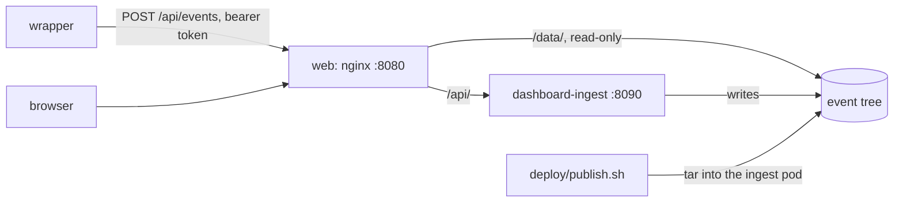

# Deploying the dashboard

Two images and one volume. `deploy/Containerfile` is the web app on UBI nginx, serving the event tree from a volume at `/srv/data` as `/data/`. `deploy/Containerfile.ingest` is the ingest service (`apps/ingest`): it writes events into that volume (`POST /events`) and replays snapshots through the pinned assembler (`POST /replay`). nginx proxies `/api/` to the service, so the app reaches it on its own origin. The decisions behind this are in `docs/adr/0003-assembler-by-git-tag.md` and `docs/adr/0005-replay-server-side.md`.



The service can keep events in PostgreSQL instead of the tree (`docs/adr/0007-store-and-query-api.md`): with `DATABASE_URL` set (`postgres://…`, or `pglite:memory` / `pglite:<directory>` for PostgreSQL in WebAssembly with no server), it stores what `POST /events` takes there and serves the tree's documents from it at the tree's paths, `GET /data/events/index.json`, `/data/events/index/<day>.json`, `/data/events/<id>.json`, `/data/sessions/<id>.json` and `/data/fleet.json`, with the same cache rules; the web app reads them with `dataRoot` set to `/api/data` in `config.json`. Without `DATABASE_URL` it keeps the tree in `EVENTS_DIR`, as below.

## On one machine

The whole stack, the volume seeded with the demo tree on its first run:

```sh
podman compose up --build        # or docker compose up --build
open http://localhost:8080
```

`WEB_PORT` and `INGEST_PORT` move the host ports when 8080 or 8090 is taken. `INGEST_TOKEN` (default `local-dev-token`) is the token `POST /events` takes. Point a wrapper at `http://localhost:8090/events`, or at `http://localhost:8080/api/events` through nginx:

```sh
curl -X POST http://localhost:8090/events \
  -H 'content-type: application/json' -H 'authorization: Bearer local-dev-token' \
  --data @event.json
```

An event appears in the stream, and its service in the fleet report, once the service has rebuilt the index and `fleet.json`, a moment after the write. `podman compose down -v` removes the volume, and the next `up` seeds it again.

The web image runs on its own too, with no sandbox, since it has no service to proxy to:

```sh
podman build -f deploy/Containerfile --build-arg BUILD_COMMIT=$(git rev-parse --short HEAD) -t dashboard:dev .
podman run --rm -p 8080:8080 -v "$PWD/packages/demo-traffic/fixtures:/srv/data:ro,Z" dashboard:dev
```

The browser tests run against either. Against the compose stack every test but the ingest project's applies; against the image alone, leave out the sandbox's:

```sh
cd apps/web
PLAYWRIGHT_BASE_URL=http://localhost:8080 pnpm exec playwright test --project chromium
PLAYWRIGHT_BASE_URL=http://localhost:8080 pnpm exec playwright test --project chromium --grep-invert sandbox
```

## On the cluster

`deploy/base` holds the web and ingest Deployments, their Services, the Route, the volume claim, the runtime config and the nginx configuration; `deploy/overlays/prod` sets the namespace (`cwa-dashboard`), the host (`dashboard.contextwindowarchitecture.io`), the image tags, TLS through cert-manager, and the single node's storage class. The ingest service runs one replica, recreated rather than rolled, since the tree has one writer.

Once, before the first apply:

```sh
oc new-project cwa-dashboard
oc -n cwa-dashboard create secret generic dashboard-ingest --from-literal=token="$(openssl rand -hex 32)"
```

Without that secret the service still replays, and refuses every write.

The images are private on Quay, so the overlay pulls with the secret `dashboard-pull`: the credentials of a Quay robot account with read access to `dashboard` and `dashboard-ingest` (the benchmark's robot, `contextwindowarchitecture+cwa`, once it is given that access):

```sh
oc -n cwa-dashboard create secret docker-registry dashboard-pull \
  --docker-server=quay.io --docker-username='contextwindowarchitecture+<robot>' --docker-password='<token>'
```

A rollout:

1. Build and push both images: run the `image` workflow on the commit, which tags each with the commit's 12-character SHA and `latest`; or build them by hand for the cluster's architecture (`podman build --platform linux/amd64 …`, then `podman push`), since a Mac builds arm64 by default.
2. Set both `newTag`s in `deploy/overlays/prod/kustomization.yaml` to that SHA, and commit.
3. `oc apply -k deploy/overlays/prod`, then `oc -n cwa-dashboard rollout status deployment/dashboard` and `deployment/dashboard-ingest`. A rollback is `oc rollout undo`.

To fill the volume with the demo tree (or any tree the generator wrote):

```sh
deploy/publish.sh packages/demo-traffic/fixtures
```

It copies the events and sessions first and `events/index.json` last, so the index never names an event that is not there, then restarts the ingest service so it reads the published index. The published index replaces the volume's: an event posted before the publish keeps its file but leaves the index.

### DNS and TLS

The host must resolve to the cluster's router before cert-manager can answer Let's Encrypt's HTTP-01 challenge. The Route names the secret cert-manager keeps (`dashboard-tls`); the API refuses a Route naming a secret that does not exist yet, so the first apply leaves the Route as it was until the Certificate is Ready, and the next apply takes it.

## Not here yet

Phase 2's query API, collector and database (`dashboard-plan.md` 12) are not part of this stack. Nothing here sends real traffic: the deployment shows demo traffic only (D11).
