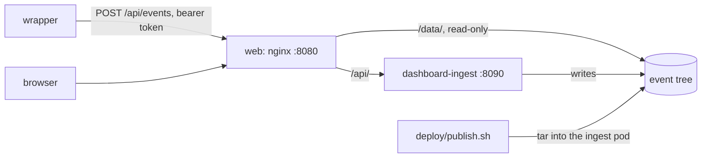

# Deploying the dashboard

Two images and one volume. `deploy/Containerfile` is the web app on UBI nginx, serving the event tree from a volume at `/srv/data` as `/data/`. `deploy/Containerfile.ingest` is the ingest service (`apps/ingest`): it writes events into that volume (`POST /events`) and replays snapshots through the pinned assembler (`POST /replay`). nginx proxies `/api/` to the service, so the app reaches it on its own origin. The decisions behind this are in `docs/adr/0003-assembler-by-git-tag.md` and `docs/adr/0005-replay-server-side.md`.



The service can keep events in PostgreSQL instead of the tree (`docs/adr/0007-store-and-query-api.md`): with `DATABASE_URL` set (`postgres://…`, or `pglite:memory` / `pglite:<directory>` for PostgreSQL in WebAssembly with no server), it stores what `POST /events` takes there and serves the tree's documents from it at the tree's paths, `GET /data/events/index.json`, `/data/events/index/<day>.json`, `/data/events/<id>.json`, `/data/sessions/<id>.json`, `/data/fleet.json` and `/data/sources.json`, with the same cache rules; the web app reads them with `dataRoot` set to `/api/data` in `config.json`. Without `DATABASE_URL` it keeps the tree in `EVENTS_DIR`, as below.

## On one machine

The whole stack, the volume seeded with the demo tree on its first run:

```sh
podman compose up --build        # or docker compose up --build
open http://localhost:8080
```

`WEB_PORT` and `INGEST_PORT` move the host ports when 8080 or 8090 is taken. `INGEST_TOKEN` (default `local-dev-token`) is the token `POST /events` takes. Point a wrapper at `http://localhost:8090/events`, or at `http://localhost:8080/api/events` through nginx:

```sh
curl -X POST http://localhost:8090/events \
  -H 'content-type: application/json' -H 'authorization: Bearer local-dev-token' \
  --data @event.json
```

An event appears in the stream, its service in the fleet report and its producers in the sources report, once the service has rebuilt the index, `fleet.json` and `sources.json`, a moment after the write. `podman compose down -v` removes the volume, and the next `up` seeds it again.

The web image runs on its own too, with no sandbox, since it has no service to proxy to:

```sh
podman build -f deploy/Containerfile --build-arg BUILD_COMMIT=$(git rev-parse --short HEAD) -t dashboard:dev .
podman run --rm -p 8080:8080 -v "$PWD/packages/demo-traffic/fixtures:/srv/data:ro,Z" dashboard:dev
```

The browser tests run against either. Against the compose stack every test but the ingest project's applies; against the image alone, leave out the sandbox's:

```sh
cd apps/web
PLAYWRIGHT_BASE_URL=http://localhost:8080 pnpm exec playwright test --project chromium
PLAYWRIGHT_BASE_URL=http://localhost:8080 pnpm exec playwright test --project chromium --grep-invert sandbox
```

## On the cluster

`deploy/base` holds the web and ingest Deployments, their Services, the Route, the volume claim, the runtime config and the nginx configuration; `deploy/overlays/prod` sets the namespace (`cwa-dashboard`), the host (`dashboard.contextwindowarchitecture.io`), the image tags, TLS through cert-manager, and the single node's storage class. The ingest service runs one replica, recreated rather than rolled, since the tree has one writer.

Once, before the first apply:

```sh
oc new-project cwa-dashboard
oc -n cwa-dashboard create secret generic dashboard-ingest --from-literal=token="$(openssl rand -hex 32)"
```

Without that secret the service still replays, and refuses every write.

The images are private on Quay, so the overlay pulls with the secret `dashboard-pull`: the credentials of a Quay robot account with read access to `dashboard` and `dashboard-ingest` (the benchmark's robot, `contextwindowarchitecture+cwa`, once it is given that access):

```sh
oc -n cwa-dashboard create secret docker-registry dashboard-pull \
  --docker-server=quay.io --docker-username='contextwindowarchitecture+<robot>' --docker-password='<token>'
```

A rollout:

1. Build and push both images: run the `image` workflow on the commit, which tags each with the commit's 12-character SHA and `latest`; or build them by hand for the cluster's architecture (`podman build --platform linux/amd64 …`, then `podman push`), since a Mac builds arm64 by default.
2. Set both `newTag`s in `deploy/overlays/prod/kustomization.yaml` to that SHA, and commit.
3. `oc apply -k deploy/overlays/prod`, then `oc -n cwa-dashboard rollout status deployment/dashboard` and `deployment/dashboard-ingest`. A rollback is `oc rollout undo`.

To fill the volume with the demo tree (or any tree the generator wrote):

```sh
deploy/publish.sh packages/demo-traffic/fixtures
```

It copies the events and sessions first and `events/index.json` last, so the index never names an event that is not there, then restarts the ingest service so it reads the published index. The published index replaces the volume's: an event posted before the publish keeps its file but leaves the index.

### DNS and TLS

The host must resolve to the cluster's router before cert-manager can answer Let's Encrypt's HTTP-01 challenge. The Route names the secret cert-manager keeps (`dashboard-tls`); the API refuses a Route naming a secret that does not exist yet, so the first apply leaves the Route as it was until the Certificate is Ready, and the next apply takes it.

## Demo traffic only

Nothing here sends real traffic: the deployment shows demo traffic only (D11), and its vault holds only the demo's bodies, the review agent's route's.

## Events in PostgreSQL

The ingest service can keep events in PostgreSQL instead of the tree (`docs/adr/0007-store-and-query-api.md`). The pages read the same documents either way; only where they come from changes: `config.json`'s `dataRoot` is `/api/data`, served by the service from the database.

On one machine, layer `docker-compose.postgres.yml` on the stack: it adds PostgreSQL (the Software Collections image, which runs under any UID, pinned by digest), gives the ingest service `DATABASE_URL`, points the app at `/api/data`, and on a first run posts the demo tree's events through `POST /events` (`deploy/seed-events.mjs`; an event already there answers 409):

```sh
podman compose -f docker-compose.yml -f docker-compose.postgres.yml up --build
```

On the cluster, `deploy/overlays/prod-postgres` is the production overlay plus `deploy/components/postgres`: a one-replica StatefulSet with its own claim, its Service, the ingest service's `DATABASE_URL` built from the secret `dashboard-postgres`, and the `/api/data` config. Switching to it:

```sh
# Once: the database's user, password and name. The password is hex, so DATABASE_URL needs no escaping.
oc -n cwa-dashboard create secret generic dashboard-postgres \
  --from-literal=user=cwa --from-literal=password="$(openssl rand -hex 24)" --from-literal=database=cwa
oc apply -k deploy/overlays/prod-postgres
oc -n cwa-dashboard rollout status statefulset/dashboard-postgres
oc -n cwa-dashboard rollout status deployment/dashboard-ingest
# The demo traffic, posted as a wrapper would, with the ingest token:
node deploy/seed-events.mjs packages/demo-traffic/fixtures/events https://dashboard.contextwindowarchitecture.io/api --token "$INGEST_TOKEN"
node deploy/seed-events.mjs packages/demo-traffic/fixtures/tenants/northwind/events https://dashboard.contextwindowarchitecture.io/api --token "$INGEST_TOKEN"
```

Applying `deploy/overlays/prod` again switches back to the tree; the StatefulSet and its claim stay until deleted by hand.

**Backups.** A custom-format dump, taken and restored inside the database's pod (or container, with `podman exec`), which the compose stack's round trip proved on 2026-10-17 (112 events dumped, the tables dropped, all 112 restored and served):

```sh
oc -n cwa-dashboard exec statefulset/dashboard-postgres -- pg_dump -U cwa -d cwa -Fc > cwa-$(date -u +%Y%m%d).dump
oc -n cwa-dashboard exec -i statefulset/dashboard-postgres -- pg_restore -U cwa -d cwa --clean --if-exists < cwa-<day>.dump
```

Keep the dumps off the cluster; the claim is node-local storage on a single node.

## Compliance bundles

`GET /api/bundles/<event id>.json` signs a compliance bundle for a stored event with an Ed25519 key, and `GET /api/signing-key.pem` serves the public key that checks it. Without a key both answer 503 and the compliance page says so. The key is the secret `dashboard-signing`, read as `SIGNING_KEY`:

```sh
openssl genpkey -algorithm ed25519 -out dashboard-signing.pem
oc -n cwa-dashboard create secret generic dashboard-signing --from-file=key.pem=dashboard-signing.pem
oc -n cwa-dashboard rollout restart deployment/dashboard-ingest
```

Keep the private key off the cluster only as long as it takes to create the secret. Locally, `SIGNING_KEY="$(cat dashboard-signing.pem)" podman compose up` passes one to the service.

A reader checks a bundle without the dashboard, with Node and this repository's script, against the public key the dashboard served:

```sh
curl -sO https://dashboard.contextwindowarchitecture.io/api/bundles/<event id>.json
curl -s https://dashboard.contextwindowarchitecture.io/api/signing-key.pem > signing-key.pem
node deploy/verify-bundle.mjs <event id>.json signing-key.pem
```

**Rotating the key**: create a new secret value and restart the service. Every bundle names its key's id (the SHA-256 of the public key), so a bundle signed before the rotation still verifies against the old public key: keep each retired public key where readers can find it, beside the date it was retired.


## Sign-in

The ingest service signs readers in through an OpenID Connect issuer (`docs/adr/0010-sign-in.md`) when it has `OIDC_ISSUER`, `OIDC_CLIENT_ID`, `OIDC_CLIENT_SECRET` and `OIDC_REDIRECT_URI` (the public address of `/api/auth/callback`) and keeps its events in PostgreSQL, where the sessions live. `OIDC_ISSUER_INTERNAL` names where the service reaches an issuer served behind the site's own proxy; the issuer's public name, which the tokens carry, is still checked. Without the settings every reader is anonymous, as before, and the masthead offers no sign-in.

Locally, Dex with its mock connector, which signs a fixed test person in with no password:

```sh
podman compose -f docker-compose.yml -f docker-compose.postgres.yml -f docker-compose.signin.yml up --build
```

Dex is at `http://localhost:${WEB_PORT}/dex`, behind the web container's proxy (`deploy/components/sign-in/dex-proxy.conf`); its configuration is a template the image renders from the environment (`deploy/compose/dex.local.yaml.tpl`).

On the cluster, `deploy/overlays/prod-sign-in` is the PostgreSQL overlay plus `deploy/components/sign-in`: Dex at `https://dashboard.contextwindowarchitecture.io/dex`, signing in members of the `contextwindowarchitecture` GitHub organisation, whose teams arrive as groups (`contextwindowarchitecture:<team>`). Before applying it:

1. A GitHub OAuth app, under the organisation's settings (Developer settings, OAuth apps): homepage `https://dashboard.contextwindowarchitecture.io`, authorization callback `https://dashboard.contextwindowarchitecture.io/dex/callback`. If the organisation restricts third-party access, approve the app for it, or Dex cannot read memberships.
2. Its credentials, and the client secret Dex and the ingest service share, into secrets without printing them:

```sh
openssl rand -hex 32 | tr -d '\n' | oc -n cwa-dashboard create secret generic dashboard-oidc --from-file=client-secret=/dev/stdin
read -r GITHUB_CLIENT_ID; read -rs GITHUB_CLIENT_SECRET
printf %s "$GITHUB_CLIENT_SECRET" | oc -n cwa-dashboard create secret generic dashboard-dex-github \
  --from-literal=client-id="$GITHUB_CLIENT_ID" --from-file=client-secret=/dev/stdin
unset GITHUB_CLIENT_SECRET
oc apply -k deploy/overlays/prod-sign-in
oc -n cwa-dashboard rollout status deployment/dashboard-dex
```

Applying `deploy/overlays/prod-postgres` again takes sign-in away; Dex's Deployment then stays until deleted by hand.

## Who may read what

With `ACCESS_FILE`, a JSON file, the service grants roles and refuses what they do not cover (`docs/adr/0011-roles.md`); without it, every reader reads everything, as before sign-in. The file grants roles to readers who have not signed in, to every signed-in reader, and by the issuer's groups; a reader holds the union of what applies to them:

```json
{
  "anonymous": [],
  "signed_in": ["viewer"],
  "groups": {
    "contextwindowarchitecture:support": ["owner:support-chat"],
    "contextwindowarchitecture:compliance": ["auditor"],
    "contextwindowarchitecture:maintainers": ["operator", "owner:*"]
  }
}
```

`viewer` reads every event's metadata and every document derived from them; `owner:<route>` (or `owner:*`) also reads that route's bodies and its compliance bundles; `auditor` reads every bundle; `operator` reads what a viewer does. A role may end in `@<tenant>` to hold in that tenant alone (`viewer@default`, `owner:support-chat@northwind`) or `@*` for all; a role without one holds in every tenant (`docs/adr/0012-tenants.md`). Another tenant's documents are at `/api/data/tenants/<tenant>/`, `/api/data/tenants.json` lists the tenants a reader may read, and bundles, corpora and shadow runs take `?tenant=`. A body a reader's roles do not cover is served withheld, with its digest, and the inspector says so. An unknown key or role stops the service at start. A reader with no role is told to sign in (401), or that their roles do not reach (403).

On the cluster, `deploy/overlays/prod-sign-in/access.json` is the file, mounted from the ConfigMap `dashboard-access`: the default tenant stays open to anonymous readers, bodies and all (D11, P3-D5); the demo's second tenant, northwind, is for signed-in members of the organisation alone, who are also auditors (`docs/adr/0012-tenants.md`). Add a team under `groups` as `"contextwindowarchitecture:<team>": [...]`, then `oc apply -k deploy/overlays/prod-sign-in`; the ConfigMap's new name rolls the ingest service.

## Drafts

A signed-in owner of a route keeps drafts of its route policy and profiles in the API (`docs/adr/0013-authoring.md`): `GET /api/drafts.json` lists the reader's own, `GET`, `PUT` and `DELETE /api/drafts/<id>.json` read, keep and remove one. They live in PostgreSQL (migrations 8 and 9), each its author's and its tenant's (`?tenant=`): another author's drafts answer 404, as does a draft of another tenant, a draft for a route the author does not own is refused, and a write from another site is refused. A draft is kept as it was saved, valid or not; nothing of it is kept in the browser's storage.

## Publish

`POST /api/drafts/<id>/publish` opens a pull request with the draft, as saved, in its tenant's policy repository (`docs/adr/0014-publish.md`): the file where the layout puts it (`deploy/policy-repository/README.md`), on the branch `cwa-dashboard/<id>`, the author and, with `{"corpus": "<name>"}`, a shadow run's counts in its body. The draft's author must still own its route, and the contract must accept the draft; a version the repository already holds is refused. Without the App, or for a tenant with no repository, it answers with the file, the path and the commands.

The App, made once per organisation on GitHub (Settings, Developer settings, GitHub Apps, New GitHub App): no callback URL, no user authorization, the webhook off; repository permissions **Contents** and **Pull requests** read and write, **Metadata** read, nothing else; installable on this account only. Generate a private key on its page, then install it on the policy repositories alone ("Only select repositories"); the installation's page's URL ends in its id. The live host's App is `cwa-dashboard-publisher`. Then, from your own terminal, so the key passes through nothing else:

```sh
oc -n cwa-dashboard create secret generic dashboard-github-app \
  --from-file=private-key.pem=<the downloaded key> \
  --from-literal=app-id=<App ID> --from-literal=installation-id=<installation id>
```

and delete the downloaded key. `deploy/components/publish` mounts the secret into the ingest pod at `/etc/dashboard/github-app` (`GITHUB_APP_DIR`) and reads `POLICY_REPOSITORIES` from the ConfigMap `dashboard-publish`, which `deploy/overlays/prod-sign-in` makes: `{"default": "contextwindowarchitecture/policies-demo"}`. Rotating the key is a new one on the App's page, the secret made again, and `oc -n cwa-dashboard rollout restart deployment/dashboard-ingest`.

A policy repository starts from `deploy/policy-repository/`: its README, `shadow.json` (the dashboard's API, the tenant, a corpus per route, the limits), the check's workflow and the two empty directories. The App cannot branch from an empty repository, so commit that first:

```sh
git clone git@github.com:contextwindowarchitecture/policies-demo.git && cd policies-demo
cp -R ../dashboard/deploy/policy-repository/. .
git add . && git commit -s -m "Lay out the policy repository" && git push origin main
```

The workflow uses the `policy-check` Action at a pinned commit of this repository, so the repository holding the Action must be one the policy repository can use: public, or, for a private policy repository, private with its Actions shared across the organisation.

## The vault

A route under `pii_scrubbed` or `digest_only` may keep its original bodies in the vault (`docs/adr/0009-body-vault.md`): its wrapper deposits each body with the ingest token at `PUT /api/bodies/<sha256>`, and the operator resolves one in the inspector with the operator token, `VAULT_TOKEN`, which must differ from the ingest token (the service refuses to start otherwise). The inspector shows a body only when its bytes hash to the digest the event holds.

Where the bodies are kept: with `DATABASE_URL`, in PostgreSQL's `cwa_bodies` table (migration 5); otherwise in `VAULT_DIR`, which the service refuses inside `EVENTS_DIR`, since the web server serves the tree under `/data/` without a token. The cluster's vault is PostgreSQL's (`prod-postgres`); the tree overlay keeps none. The operator token is the secret `dashboard-vault`:

```sh
# The token goes from openssl straight into the secret, never printed; the operator reads it back
# from there when resolving: oc -n cwa-dashboard extract secret/dashboard-vault --to=-
# tr drops openssl's newline, which would otherwise be part of the token.
openssl rand -hex 32 | tr -d '\n' | oc -n cwa-dashboard create secret generic dashboard-vault --from-file=token=/dev/stdin
oc -n cwa-dashboard rollout restart deployment/dashboard-ingest
# The demo's vaulted bodies (the review agent's route), deposited as its wrapper would:
node deploy/seed-vault.mjs packages/demo-traffic/vault https://dashboard.contextwindowarchitecture.io/api --token "$INGEST_TOKEN"
```

Locally, `docker-compose.postgres.yml` deposits the demo's bodies on a first run, and `VAULT_TOKEN=… podman compose -f docker-compose.yml -f docker-compose.postgres.yml up` gives the service an operator token.

**A route's owner resolves its own bodies** by session, without the operator token: the inspector asks `GET /api/bodies/<sha256>?event=<event id>` (with `&tenant=` for another tenant's event), which answers only a signed-in reader whose roles own the event's route, and only for a digest that event holds. An anonymous reader never resolves, whatever the access file grants. Every resolution, by session or by token, is a line in the ingest service's log: `vault: resolved <sha256> for <subject, or the operator token> via <event> at <time>`.

**Erasing a body**, for an erasure request: `curl -X DELETE -H "authorization: Bearer $VAULT_TOKEN" https://dashboard.contextwindowarchitecture.io/api/bodies/<sha256>` answers 204, or 404 when the vault does not hold it. The event keeps its digest and its counts; the inspector then says the vault does not hold the body.

**What it holds** is the PII the redaction kept out of the events, under the database's protection and one token: the backups above carry `cwa_bodies` with the events, so they are kept as carefully. Rotating the operator token is a new secret value and a restart; nothing stored depends on it.

## Shadow regression

A shadow run replays a frozen corpus of stored events twice through the pinned assembler, as recorded and with a candidate route policy, profile or both, and reports every assembly that changes (`docs/adr/0008-shadow-regression.md`). Only events recorded in `full` replay; the rest are counted as skipped, with why.

A corpus is frozen with the ingest token, from one tenant's events (`"tenant"` in the request; the default when absent), from event ids or from the stream's index filtered by `route`, `outcome` or `profile` (at most 200 events, `limit` fewer). It lives in the store (`corpora/` in the tree, `cwa_corpora` in PostgreSQL) and is never overwritten: freezing a name again answers 409.

```sh
curl -s -X POST https://dashboard.contextwindowarchitecture.io/api/corpora \
  -H "authorization: Bearer $INGEST_TOKEN" -H 'content-type: application/json' \
  -d '{"name": "support-chat-baseline", "from": {"route": "support-chat", "outcome": "assembled", "limit": 100}}'
curl -s https://dashboard.contextwindowarchitecture.io/api/corpora.json
```

`POST /api/shadow` with `{ "corpus": <name>, "candidate": { "route_policy": …, "profile": … } }` runs one: it takes no token, since it writes nothing, and runs one at a time, answering 503 while another is under way. The shadow page asks for it, and a pull request in a policy repository can, with the script or the Action around it:

```sh
node deploy/shadow-check.mjs --api https://dashboard.contextwindowarchitecture.io/api \
  --corpus support-chat-baseline [--tenant <tenant>] --profile profiles/cache-first-chat.json \
  --max-refusals-added 0 --max-shedding-increase 0 --max-candidate-rejected 0 --report shadow.json
```

```yaml
- uses: contextwindowarchitecture/dashboard/.github/actions/shadow-regression@<commit>
  with:
    api: https://dashboard.example/api
    corpus: support-chat-baseline
    profile: profiles/cache-first-chat.json
```

The script exits 0 within every limit, 1 over one, and 2 when it could not run (a usage error, a corpus the service does not hold, a service that does not answer). Every limit is 0 unless given. A baseline that does not reproduce its recorded hash is reported, not failed on: it is a difference between the recording implementation and this one, not the candidate's.

A policy repository (`docs/adr/0014-publish.md`) runs the whole of it on every pull request with `deploy/policy-check.mjs`, or the `policy-check` Action around it. It reads the repository's `shadow.json` (the dashboard's `api`, the `tenant`, a corpus per route under `corpora`, and the `limits`, each 0 unless given), checks that every file under `route-policies/` and `profiles/` is where the layout puts it and holds what its path names, fails an edit to or a removal of a published version, and shadows each route the pull request changes, its new route policy and profile together. A route with no corpus fails, so nothing merges unshadowed; it exits 0 when all holds, 1 when something does not and 2 when it cannot run, and a check that cannot run never passes.

```sh
node deploy/policy-check.mjs --base origin/main --root <checkout of the policy repository>
```

```yaml
- uses: actions/checkout@v4
  with:
    fetch-depth: 0
- uses: contextwindowarchitecture/dashboard/.github/actions/policy-check@<commit>
  with:
    base: ${{ github.event.pull_request.base.sha }}
```
