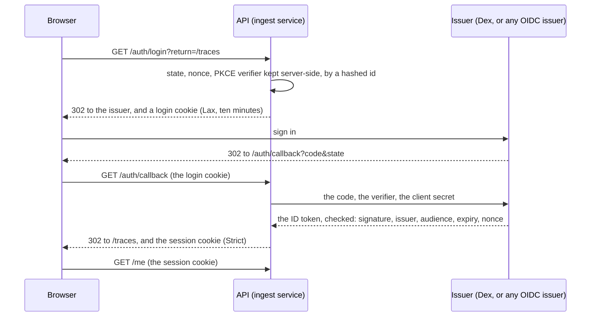

# ADR-0010: The API signs readers in with OpenID Connect, and the page never holds a token

- Status: accepted
- Date: 2026-10-17

## Context

Phase 3 decides who may read what (dashboard-plan.md, Phase 3). Every read already goes through the API in PostgreSQL mode (ADR-0007), so identity belongs there. The page's Content Security Policy allows only its own scripts, so no identity provider's script can run in it, and a token the page could read is a token a script injected into it could take. The maintainer chose OpenID Connect as a backend-for-frontend (P3-D2), with Dex in front of GitHub as the live host's issuer.

## Decision

- **The API is the OpenID Connect client**, with the authorization code flow, PKCE (S256), `state` and `nonce`, through `openid-client` (panva), which validates the ID token against the issuer's published keys. Configuration: `OIDC_ISSUER`, `OIDC_CLIENT_ID`, `OIDC_CLIENT_SECRET` (a secret) and `OIDC_REDIRECT_URI`, the public address of `/auth/callback`. Without them, sign-in answers 503 and the page offers none.
- **The page holds only a cookie it cannot read**: `cwa_session`, `HttpOnly`, `Secure`, `SameSite=Strict`, `Path=/`, a random 256-bit id. The database keeps its SHA-256, so a copy of the database opens no session. A session lasts at most twelve hours and ends after two idle; `POST /auth/logout` ends it at once. No access or refresh token is kept: the ID token's claims are read once, at sign-in.
- **The login in flight** is a row keyed by the SHA-256 of a second random id, carried in `cwa_login` (`HttpOnly`, `Secure`, `SameSite=Lax`, ten minutes): Lax, because the issuer's redirect back is a top-level navigation from another site, which a Strict cookie would not follow. A login row is used once.
- **Where a reader returns** is a path on this site only: `return` must start with one `/` and not two, else the reader returns to `/`.
- **Writes are guarded** by the Strict cookie and an `Origin` check: a request with a session cookie and an `Origin` other than the site's is refused.
- **Sessions need PostgreSQL** (migration 6): the tree mode stays anonymous (P3-D8).
- **What a session knows**: the issuer's `sub`, a display name (`name`, else `preferred_username`, else `email`), the email, and the `groups` claim, which DP-16 maps to roles. `GET /me` answers it, or that no one is signed in, and whether sign-in is configured.

## Consequences

- Any OIDC issuer an adopter runs works; the live host's is Dex with GitHub as its connector, so GitHub organisation and team membership arrive as groups.
- A reader signs in again after twelve hours, or two idle; nothing refreshes silently.
- The issuer's own session survives a logout here; ending it there (RP-initiated logout) is left open.

## Left open

RP-initiated logout, back-channel logout, and sessions for automation (the ingest and vault tokens stay for that).
