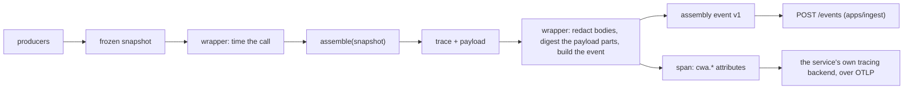

# CWA telemetry conventions

How a wrapper around a conformant CWA assembler records each `assemble()` call, so that wrappers in Python, TypeScript, Go and Rust emit the same thing and the dashboard reads them all one way. The wrapper calls the assembler, times the call, and emits one **assembly event** (`packages/telemetry/schemas/assembly-event.v1.schema.json`): the frozen snapshot and the trace inside an envelope. Over OpenTelemetry it also records a span whose attributes mirror the event's fields one to one (the table below), so a trace view and the dashboard agree.

The wrapper never changes what the assembler decides: it reads the snapshot it passes in and the trace that comes back.

The event travels by HTTP, never through an OpenTelemetry collector: it holds the whole snapshot, far over the size a span attribute or a log record carries in common backends. The span carries the summary below and the `event_id`, so a trace view links to the event.

## Naming

Every attribute this document defines is under `cwa.`. OpenTelemetry's naming guidance says "It is not recommended to use existing OpenTelemetry semantic convention namespace as a prefix" for a project's own attributes, since it "may result in a name clash in the future", so none sits under `gen_ai.` or any other namespace OpenTelemetry defines. Where OpenTelemetry defines an attribute with the same meaning, a wrapper sets it as well: `service.name`, `service.instance.id` and `deployment.environment.name` below, and, for a call in a session, the GenAI conventions' `gen_ai.conversation.id` ("the unique identifier for a conversation (session, thread)") with the value of `cwa.session.id`. `gen_ai.usage.input_tokens` is not reused: it counts a model call's tokens, and `cwa.result.input_tokens` counts what the assembler fitted.

## Attributes

One row per event field. A field path uses dots between properties and `[]` for the items of an array; `snapshot.` and `trace.` paths are the published contract's fields. A test holds this table to the event schema: every field it names exists, and every field of the envelope is here.

| Attribute | Event field | Type | Notes |
| --- | --- | --- | --- |
| `cwa.event_id` | `event_id` | string | A ULID |
| `(span start time)` | `recorded_at` | timestamp | The span starts when the wrapper calls `assemble()` |
| `(span duration)` | `timings_ms.total` | duration | The wrapper's measurement of the whole call |
| `(span trace id)` | `otel.trace_id` | trace id | Shared with the model call the payload feeds, through `traceparent` |
| `(span id)` | `otel.span_id` | span id | |
| `service.name` | `service.name` | string | OpenTelemetry's resource attribute |
| `service.instance.id` | `service.instance` | string | OpenTelemetry's resource attribute |
| `deployment.environment.name` | `service.environment` | string | `demo` for demo traffic |
| `cwa.assembler.language` | `assembler.language` | string | `python`, `typescript`, `go` or `rust`, as `implementations/index.json` names them |
| `cwa.assembler.name` | `assembler.name` | string | The package name |
| `cwa.assembler.version` | `assembler.version` | string | |
| `cwa.contract.repository` | `contract.repository` | string | |
| `cwa.contract.commit` | `contract.commit` | string | The specification commit the assembler's lock pins |
| `cwa.contract.lock_sha256` | `contract.lock_sha256` | string | See Contract lock |
| `cwa.spec` | `trace.context.spec` | string | `cwa/draft` |
| `cwa.session.id` | `session.id` | string | See Sessions |
| `cwa.session.turn_index` | `session.turn_index` | int | From 0 |
| `cwa.redaction_mode` | `redaction_mode` | string | See Redaction |
| `cwa.outcome` | `outcome` | string | `assembled`, `refused` or `rejected` |
| `cwa.trace_id` | `trace.trace_id` | string | The CWA trace's own id, not OpenTelemetry's |
| `cwa.snapshot_digest` | `trace.context.snapshot_digest` | string | The digest `conformance/README.md` defines |
| `cwa.route` | `snapshot.route_policy.route` | string | |
| `cwa.route_policy.version` | `snapshot.route_policy.version` | string | |
| `cwa.profile.id` | `snapshot.profile.id` | string | |
| `cwa.profile.version` | `snapshot.profile.version` | int | |
| `cwa.budget.input` | `trace.budget.input` | int | |
| `cwa.result.input_tokens` | `trace.result.input_tokens` | int | Absent unless assembled |
| `cwa.refused.reason` | `trace.refused.reason` | string | A refusal code of `contract/reasons.json`; absent unless refused |
| `cwa.excluded.reason_codes` | `trace.excluded[].reason` | string[] | The distinct codes, in `contract/reasons.json` order |
| `cwa.payload.sha256` | `payload.hash` | string | Equal to `trace.result.hash`; the payload itself is never emitted |
| `cwa.payload.bytes` | `payload.bytes` | int | The payload's length in UTF-8 bytes |
| `cwa.payload.part.sections` | `payload.parts[].section` | string[] | See Payload parts; one entry per part, in request order |
| `cwa.payload.part.ids` | `payload.parts[].id` | string[] | An empty string for a part with no id |
| `cwa.payload.part.sha256` | `payload.parts[].sha256` | string[] | |
| `cwa.payload.part.bytes` | `payload.parts[].bytes` | int[] | |
| `cwa.rejection.problems` | `rejection.problems` | string[] | The assembler's checks in words; only when rejected |
| `cwa.vault.base` | `vault.base` | string | Phase 2 |
| `cwa.vault.kms_key_id` | `vault.kms_key_id` | string | Phase 2 |

The snapshot and the trace are carried whole in the event, not as attributes: they are too large for a span, and the inspector joins them item by item.

## Redaction

Bodies can carry personal data; everything else about an item cannot be hidden, because an audit needs it. Redaction is therefore a property of the wrapper, applied before the event leaves the process, and it touches bodies only.

**The setting** is `routes.<route>.redaction_mode` in the wrapper's configuration, one of `full`, `pii_scrubbed` or `digest_only`, `full` by default. Every wrapper reads this key. The dashboard never redacts, scrubs or reveals: it shows what the event holds, names the mode on every event, and, beside a redacted body, names this setting as the way to see it (R-DASH-2).

**What a mode changes** is the `body` of every candidate in `snapshot.batches[].items[]` and of every one of its `variants[]` (for a rejected event, in `rejection.snapshot`). Every other field of every item stays as the producer emitted it: authority, trust, tier, freshness, expires, source, source version, lineage, injection risk, relevance, scope, and the batch's producer (R-DASH-1).

| Mode | A body becomes | Replayable in the sandbox |
| --- | --- | --- |
| `full` | itself | yes, and its hash is compared with the recorded one |
| `pii_scrubbed` | `{"redacted": "pii_scrubbed", "text": "<the scrubbed text>", "content_sha256": "…", "token_counts": {"<tokenizer>": n}}` | yes, with `text` put back as the body, but never called a match: the counts differ |
| `digest_only` | `{"redacted": "digest_only", "content_sha256": "…", "token_counts": {"<tokenizer>": n}}` | no; see `docs/rfc-digested-replay.md` and, from Phase 2, the vault |

- `content_sha256` is the lowercase SHA-256 of the original body: of its UTF-8 bytes when it is a string, otherwise of its RFC 8785 serialization (a candidate's body can be anything until admission checks it).
- `token_counts` holds one entry, keyed by the snapshot's `tokenizer`, counting the original body with that tokenizer as the assembler would. It is empty when the body is not a string.
- A full event carries no object of either form as a body; the schema refuses one.

From Phase 2 a route may also deposit original bodies in a content-addressed vault (`vault`), so that revealing a body becomes an access decision rather than a data loss.

## Payload parts

Placement decides how much of one call's payload the next call repeats, which is what provider prompt caches reuse. A wrapper records what it can see of that without the renderer's knowledge: the parts the renderer's published payload format delimits, each by its SHA-256 and its size, in request order (`payload.parts`). It reads them from the payload, as it reads the trace, and renders nothing.

| Renderer | Parts | What the dashboard can say |
| --- | --- | --- |
| `cwa-message-blocks/v1` | every `system`, `tools` and user-content entry, each with its item's `id` | how many leading occurrences each turn reused, and which one changed first |
| `cwa-messages/v1` | every `system` and `tools` entry with its `id`, then the user message's `content` as one part with no id | whether the governance entries were reused, and whether the user message was, as a whole |
| `fixture-xml/v1` | none: the payload is one undelimited text | not available |

The request order is `system`, then `tools`, then the user content, whatever order the payload's JSON members take. A part's `sha256` is the SHA-256 of its text's UTF-8 bytes and `bytes` that text's length; a part's text is the entry's `text`, or for the one-part content of `cwa-messages/v1`, the message's `content`. Under a redaction mode the parts are still the rendered text's digests, which the payload hash already covers.

The session document compares each assembled turn's parts with the previous assembled turn's, in order, by section, id and digest, and counts the leading parts that are equal (`reused_parts`); a turn or a predecessor with no parts is not compared. This is the wrapper's view of the payload, not the provider's cache, and the page says so.

`docs/rfc-rendered-digests.md` (RFC-D2) proposes that the specification's trace carry a digest for every included occurrence under every renderer, which would make this uniform across renderers and fixed by the conformance cases.

## Contract lock

`contract.lock_sha256` is the lowercase SHA-256 of the bytes of the assembler's vendored lock file (`vendor/cwa.lock.json` in each assembler), and `contract.commit` the `spec_commit` it records. Two services with the same `lock_sha256` run against the same contract files; the fleet page compares each with the lock this dashboard vendors.

## Sessions

The contract has no sessions. A wrapper that serves a conversation or an agent loop assigns `session.id` (stable across the conversation) and `session.turn_index` (0, 1, 2 … in the order of the calls). A call outside any conversation omits `session`.

## Timing

`timings_ms.total` is the wall-clock time around the `assemble()` call as the wrapper measures it, in milliseconds. It is outside the payload hash and not deterministic (R-23). An assembler's own per-stage timings, when it emits them, stay in `trace.timings`; the dashboard shows both and says whose measurement each is.
