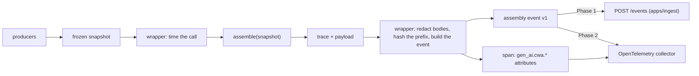

# CWA telemetry conventions

How a wrapper around a conformant CWA assembler records each `assemble()` call, so that wrappers in Python, TypeScript, Go and Rust emit the same thing and the dashboard reads them all one way. The wrapper calls the assembler, times the call, and emits one **assembly event** (`packages/telemetry/schemas/assembly-event.v1.schema.json`): the frozen snapshot and the trace inside an envelope. Over OpenTelemetry it also records a span whose attributes mirror the event's fields one to one (the table below), so a trace view and the dashboard agree.

The wrapper never changes what the assembler decides: it reads the snapshot it passes in and the trace that comes back.

## Attributes

One row per event field. A field path uses dots between properties and `[]` for the items of an array; `snapshot.` and `trace.` paths are the published contract's fields. A test holds this table to the event schema: every field it names exists, and every field of the envelope is here.

| Attribute | Event field | Type | Notes |
| --- | --- | --- | --- |
| `gen_ai.cwa.event_id` | `event_id` | string | A ULID |
| `(span start time)` | `recorded_at` | timestamp | The span starts when the wrapper calls `assemble()` |
| `(span duration)` | `timings_ms.total` | duration | The wrapper's measurement of the whole call |
| `(span trace id)` | `otel.trace_id` | trace id | Shared with the model call the payload feeds, through `traceparent` |
| `(span id)` | `otel.span_id` | span id | |
| `service.name` | `service.name` | string | OpenTelemetry's resource attribute |
| `service.instance.id` | `service.instance` | string | OpenTelemetry's resource attribute |
| `deployment.environment.name` | `service.environment` | string | `demo` for demo traffic |
| `gen_ai.cwa.assembler.language` | `assembler.language` | string | `python`, `typescript`, `go` or `rust`, as `implementations/index.json` names them |
| `gen_ai.cwa.assembler.name` | `assembler.name` | string | The package name |
| `gen_ai.cwa.assembler.version` | `assembler.version` | string | |
| `gen_ai.cwa.contract.repository` | `contract.repository` | string | |
| `gen_ai.cwa.contract.commit` | `contract.commit` | string | The specification commit the assembler's lock pins |
| `gen_ai.cwa.contract.lock_sha256` | `contract.lock_sha256` | string | See Contract lock |
| `gen_ai.cwa.spec` | `trace.context.spec` | string | `cwa/draft` |
| `gen_ai.cwa.session.id` | `session.id` | string | See Sessions |
| `gen_ai.cwa.session.turn_index` | `session.turn_index` | int | From 0 |
| `gen_ai.cwa.redaction_mode` | `redaction_mode` | string | See Redaction |
| `gen_ai.cwa.outcome` | `outcome` | string | `assembled`, `refused` or `rejected` |
| `gen_ai.cwa.trace_id` | `trace.trace_id` | string | The CWA trace's own id, not OpenTelemetry's |
| `gen_ai.cwa.snapshot_digest` | `trace.context.snapshot_digest` | string | The digest `conformance/README.md` defines |
| `gen_ai.cwa.route` | `snapshot.route_policy.route` | string | |
| `gen_ai.cwa.route_policy.version` | `snapshot.route_policy.version` | string | |
| `gen_ai.cwa.profile.id` | `snapshot.profile.id` | string | |
| `gen_ai.cwa.profile.version` | `snapshot.profile.version` | int | |
| `gen_ai.cwa.budget.input` | `trace.budget.input` | int | |
| `gen_ai.cwa.result.input_tokens` | `trace.result.input_tokens` | int | Absent unless assembled |
| `gen_ai.cwa.refused.reason` | `trace.refused.reason` | string | A refusal code of `contract/reasons.json`; absent unless refused |
| `gen_ai.cwa.excluded.reason_codes` | `trace.excluded[].reason` | string[] | The distinct codes, in `contract/reasons.json` order |
| `gen_ai.cwa.payload.sha256` | `payload.hash` | string | Equal to `trace.result.hash`; the payload itself is never emitted |
| `gen_ai.cwa.payload.bytes` | `payload.bytes` | int | The payload's length in UTF-8 bytes |
| `gen_ai.cwa.prefix.sha256` | `prefix.sha256` | string | Not emitted; see Prefix |
| `gen_ai.cwa.prefix.through_slot` | `prefix.through_slot` | string | |
| `gen_ai.cwa.prefix.bytes` | `prefix.bytes` | int | |
| `gen_ai.cwa.rejection.problems` | `rejection.problems` | string[] | The assembler's checks in words; only when rejected |
| `gen_ai.cwa.vault.base` | `vault.base` | string | Phase 2 |
| `gen_ai.cwa.vault.kms_key_id` | `vault.kms_key_id` | string | Phase 2 |

The snapshot and the trace are carried whole in the event, not as attributes: they are too large for a span, and the inspector joins them item by item.

## Redaction

Bodies can carry personal data; everything else about an item cannot be hidden, because an audit needs it. Redaction is therefore a property of the wrapper, applied before the event leaves the process, and it touches bodies only.

**The setting** is `routes.<route>.redaction_mode` in the wrapper's configuration, one of `full`, `pii_scrubbed` or `digest_only`, `full` by default. Every wrapper reads this key. The dashboard never redacts, scrubs or reveals: it shows what the event holds, names the mode on every event, and, beside a redacted body, names this setting as the way to see it (R-DASH-2).

**What a mode changes** is the `body` of every candidate in `snapshot.batches[].items[]` and of every one of its `variants[]` (for a rejected event, in `rejection.snapshot`). Every other field of every item stays as the producer emitted it: authority, trust, tier, freshness, expires, source, source version, lineage, injection risk, relevance, scope, and the batch's producer (R-DASH-1).

| Mode | A body becomes | Replayable in the sandbox |
| --- | --- | --- |
| `full` | itself | yes, and its hash is compared with the recorded one |
| `pii_scrubbed` | `{"redacted": "pii_scrubbed", "text": "<the scrubbed text>", "content_sha256": "…", "token_counts": {"<tokenizer>": n}}` | yes, with `text` put back as the body, but never called a match: the counts differ |
| `digest_only` | `{"redacted": "digest_only", "content_sha256": "…", "token_counts": {"<tokenizer>": n}}` | no; see `docs/rfc-digested-replay.md` and, from Phase 2, the vault |

- `content_sha256` is the lowercase SHA-256 of the original body: of its UTF-8 bytes when it is a string, otherwise of its RFC 8785 serialization (a candidate's body can be anything until admission checks it).
- `token_counts` holds one entry, keyed by the snapshot's `tokenizer`, counting the original body with that tokenizer as the assembler would. It is empty when the body is not a string.
- A full event carries no object of either form as a body; the schema refuses one.

From Phase 2 a route may also deposit original bodies in a content-addressed vault (`vault`), so that revealing a body becomes an access decision rather than a data loss.

## Prefix

`prefix` was meant to let the dashboard measure whether a route's leading payload stays stable from turn to turn, which is what makes provider prompt caching work. **Wrappers do not emit it.** Finding where an occurrence's rendering lies in the payload is the renderer's knowledge, and under `cwa-messages/v1` the payload's leading bytes are not even the request's leading content (RFC 8785 orders its members `messages`, `system`, `tools`). `docs/rfc-rendered-digests.md` (RFC-D2) proposes instead that the specification's trace carry a digest of each included occurrence's rendered text, from which prefix stability follows with no renderer knowledge in any wrapper. If it is adopted, `prefix` is removed from the envelope before v1 is first published; until then the dashboard shows prefix stability as "Not available".

## Contract lock

`contract.lock_sha256` is the lowercase SHA-256 of the bytes of the assembler's vendored lock file (`vendor/cwa.lock.json` in each assembler), and `contract.commit` the `spec_commit` it records. Two services with the same `lock_sha256` run against the same contract files; the fleet page compares each with the lock this dashboard vendors.

## Sessions

The contract has no sessions. A wrapper that serves a conversation or an agent loop assigns `session.id` (stable across the conversation) and `session.turn_index` (0, 1, 2 … in the order of the calls). A call outside any conversation omits `session`.

## Timing

`timings_ms.total` is the wall-clock time around the `assemble()` call as the wrapper measures it, in milliseconds. It is outside the payload hash and not deterministic (R-23). An assembler's own per-stage timings, when it emits them, stay in `trace.timings`; the dashboard shows both and says whose measurement each is.
